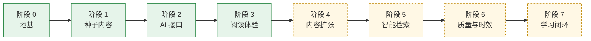

# 🗺️ ROADMAP · 项目完善计划

> 目标：把本仓库建成一个**准确、多源、讲得明白**的全学科信息搜集与知识沉淀系统，并让 AI 能以"分层记忆、按需加载"的方式高效使用它。
> 状态标记：✅ 已完成 · 🚧 进行中 · ⏳ 计划中

## 总体路线

---

## ✅ 阶段 0：地基（2026-10-06）

- ✅ 分析参考仓库：[`info-search`](https://github.com/1739467001-svg/info-search)（12 篇文档）与 [`Information-Search-Agent`](https://github.com/1739467001-svg/Information-Search-Agent)（分析时为空仓库），完成"去劣存优"对照（见 [ARCHITECTURE 第 5 节](system/ARCHITECTURE.md)）
- ✅ 分层记忆架构：L0 登记簿 / L1 卡片 / L2 章节 / 图层，附实证依据
- ✅ 体系规范：[研究流程](system/research-protocol.md)、[来源规范](system/source-policy.md)、[写作规范](system/writing-standard.md)、[分类体系](system/taxonomy.md)
- ✅ 六种条目模板：概念、专题、事件、人物、地点、作品
- ✅ `kb.py` 命令行（检索、校验、索引、学习路径、Anki 导出），仅依赖 Python 标准库
- ✅ 规范即代码：`kb.py check` + 15 项单元测试 + CI

## ✅ 阶段 1：种子内容（2026-10-06）

四个深度级条目，横跨四个领域，示范体系在不同学科上的适用性：

| 条目 | 领域 | 示范了什么 |
|---|---|---|
| [注意力机制](kb/tech-ai/attention-mechanism.md) | 技术与 AI | 公式推导 + 手算例子 + 学术争议；回应"注意力与上下文"的设计动机 |
| [上下文工程](kb/tech-ai/context-engineering.md) | 技术与 AI | 新兴概念如何处理"缺乏学术定义"（置信度如实定为中）；用本仓库做实测例子 |
| [熵](kb/natural-sciences/entropy.md) | 自然科学 | 跨学科同名概念的辨析（热力学熵 vs 信息熵）；三个可复算例子 |
| [丝绸之路](kb/history/silk-road.md) | 历史 | 史学概念的"名称考古"；原始文献（《史记》）与多派史观并列 |

## ✅ 阶段 2：AI 接口（2026-10-06）

- ✅ [AGENTS.md](AGENTS.md)：跨工具通用的协作协议（核心规则 + 路由表，细则按需读取）
- ✅ Claude Code 技能：`/research`、`/deepen`、`/review`
- ✅ MCP 服务 `info-kb`：10 个只读工具，任何支持 MCP 的客户端都能做分层检索

## ✅ 阶段 3：阅读体验（2026-10-06）

- ✅ 网页阅读器：搜索、领域导航、卡片高亮、公式（KaTeX）、图表（Mermaid）、脚注悬停、关系图（D3）、深浅色、手机适配
- 🚧 GitHub Pages 发布：工作流已就绪，**需要你在仓库设置中开启**（见下方"需要你做的事"）

---

## ⏳ 阶段 4：内容扩张（下一步）

| # | 任务 | 说明 | 验收标准 |
|---|---|---|---|
| 4.1 | 迁移 V1 的 12 篇文档 | 重新核实来源；按"一个概念一个文件"拆分（如"机器学习全景"拆为一个专题 + 深度学习、强化学习、持续学习等概念条目） | 全部通过 `kb.py check`；来源全部重新访问 |
| 4.2 | 补齐研究前沿的枢纽节点 | 优先被引用最多的待建条目，见 [graph/frontier.md](graph/frontier.md)（如 transformer、softmax、大语言模型、信息熵） | 每个新条目 ≥ 标准级 |
| 4.3 | 每个领域一个专题（topic）作为导航地图 | 专题只做版图和脉络，链接到概念条目 | 10 个领域全部有入口 |
| 4.4 | 规模目标 | 50 个条目、10 个领域全覆盖 | 深度级 ≥ 50% |

## ⏳ 阶段 5：智能检索

- **混合检索**：关键词 + 向量语义检索（本地嵌入模型或 API），解决同义词、跨语言问题；MCP 新增 `kb_semantic` 工具
- **AI 建议关系**：根据正文自动提出 `relations` 候选，人工确认后写入，减少"孤岛条目"
- **跨条目一致性检查**：同一事实（日期、数字、人名）在不同条目中是否一致

## ⏳ 阶段 6：质量与时效

- **定期复核**：用定时任务每周运行 `/review`；`review_after` 到期的条目自动生成待办（GitHub Issue）
- **来源存档**：关键来源附 Web Archive 快照链接，防止链接失效
- **外链健康检查**：CI 中定期检测来源链接是否仍可访问
- **多智能体研究**：多个子代理并行检索不同类别的来源，再由独立的"核查员"代理逐条核对论断（红队审查）

## ⏳ 阶段 7：学习闭环

- ✅ 自测题导出 Anki（`kb.py anki`）
- ⏳ 网页阅读器中的学习路径视图（沿"前置知识"关系可视化）
- ⏳ "我的思考"覆盖率统计：哪些条目你已经写过自己的理解
- ⏳ 每周学习摘要：新增条目、到期复习、建议下一步

---

## 📏 衡量指标

| 指标 | 当前（2026-10-06） | 目标 |
|---|---|---|
| `kb.py check` 错误数 | 0 | 始终为 0（CI 保证） |
| 条目数 / 覆盖领域 | 4 / 3 | 50 / 10 |
| 深度级占比 | 100% | ≥ 50%（扩张期允许标准级） |
| 平均来源数 | ≈ 15 | ≥ 8 |
| 【待核】论断数 | 0 | 持续下降 |
| 全文核实来源占比 | 偏低（本次环境大多只能读摘要） | 逐步提高：在能访问原文的环境中复核关键来源 |

## 🙋 需要你做的事

1. **审阅并合并**本次的改动（分支 `claude/peaceful-allen-ugt3eq`）。
2. **（可选）开启网页阅读器**：Settings → Pages → Source 选 "GitHub Actions"；Settings → Secrets and variables → Actions → Variables 新建 `ENABLE_PAGES = true`。
3. **写下"我的思考"**：读完种子条目后，在每篇末尾写几句自己的理解——这是知识库和资料堆的分界线。
4. **往 [inbox.md](inbox.md) 里丢词**：想到什么就记下来，下次运行 `/review` 时会被纳入建议。
