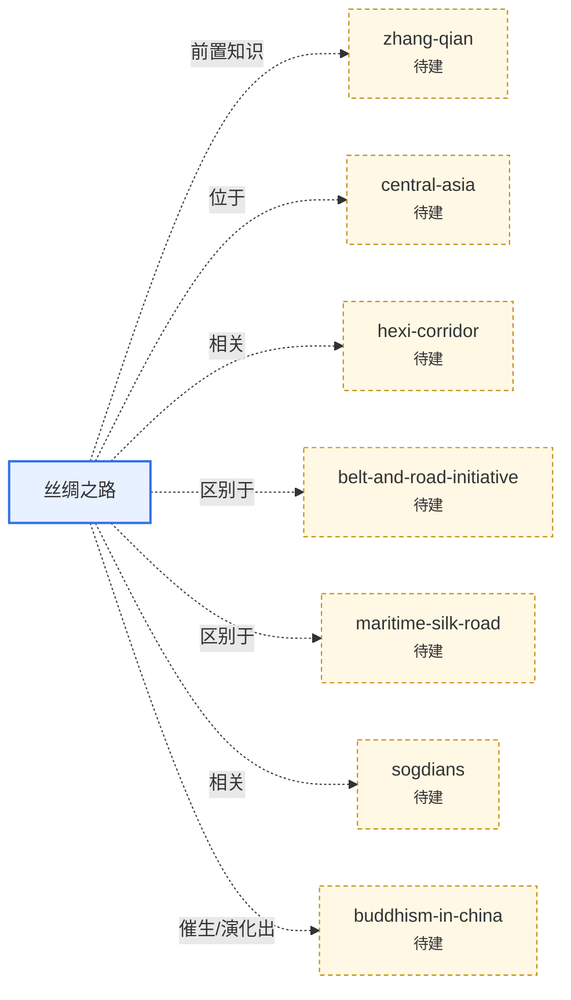

# ⏳ 历史（`history`）

**范围**：历史事件、时代、文明与史学概念

> 本页上半部分可手写领域导读；`AUTO` 区块由 `python3 tools/kb.py index` 自动维护。

## 条目

<!-- AUTO:START -->
### 概念

- [丝绸之路（Silk Road）](silk-road.md) — 19 世纪学者对古代欧亚之间陆海贸易与文化交流网络的统称；不是一条路，也不只运丝绸。 `🌳深度`

### 关系图（本领域 + 一跳邻居）

<!-- AUTO:END -->
