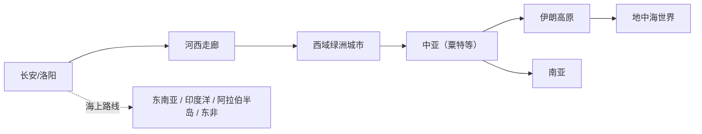

# 丝绸之路（Silk Road / Silk Roads）

<!-- CARD:START -->
> **一句话**："丝绸之路"是 19 世纪德国地理学家李希霍芬起的名字，用来统称古代连接东亚、中亚、西亚、南亚乃至欧洲与非洲的陆上（后来也包括海上）贸易与交流网络。
>
> **30 秒版**：古人自己并不这么叫它——这个名字是 1877 年才出现的。它也不是一条路，而是由许多条随时代变化、没有路标的小路连成的网络；运的也不只是丝绸，还有各种本地货物，以及更重要的宗教、技术、语言和艺术。中国史书把张骞出使西域称为"凿空"，视为这条交流通道开通的标志。2014 年，其中的"长安—天山廊道"被列入世界遗产。

**关键要点**

- 名字的由来：李希霍芬 1877 年在《中国》一书中提出 Seidenstraße（丝绸之路）
- 是网络不是一条路：联合国教科文组织用复数 "Silk Roads"，指陆海交织的路线网
- 张骞第一次出使（前 139 年出发、前 126 年返回，历时 13 年）被《史记》称为"凿空"
- 史学界有争议：贸易规模到底有多大？是"世界历史的中心"还是被浪漫化的概念？
- 不要和 2013 年提出的"一带一路"倡议混为一谈：后者是当代政策，借用了这个历史名称

**最常见的误解**：❌ 古代有一条从长安直通罗马、专门运丝绸的大道 → ✅ 是许多段接力式的地方路线，商人很少走完全程，货物也远不止丝绸
<!-- CARD:END -->

> 📚 **前置知识**：汉朝与匈奴的关系、中亚的大致地理 ｜ 🎯 **读完你应该能**：说清"丝绸之路"这个名字从哪来、指什么；讲出张骞出使的经过与意义；区分丝绸之路、海上丝绸之路与"一带一路"；理解史学界对它的不同评价

---

## 1. 是什么：定义与口径

**定义**（多来源交叉）：

> 1877 年，德国地理学家费迪南·冯·李希霍芬（Ferdinand von Richthofen）在其关于中国的多卷本著作中提出 "Seidenstrasse"（丝绸之路）一词，用来指古代从中国经中亚通往西方的陆上通道[^nyu][^cssn]。李希霍芬也使用过复数形式 Seidenstrassen，以及"交通路线""贸易路线"等其他说法[^waugh]。
>
> 联合国教科文组织的界定：被称为"丝绸之路"的陆上与海上贸易网络，把起源于东亚、南亚、东南亚的众多民族与文化联系起来，穿越中亚、俄罗斯草原、伊朗与安纳托利亚高原、阿拉伯半岛，延伸至北非、东北非与东欧、南欧；它们运载的不只是商品，还有知识、思想、文化与信仰[^unesco-about]。

**白话拆解**：丝绸之路是**后人起的一个"总称"**，把两千多年里欧亚大陆上无数条贸易与交流路线打包成一个概念。就像"四大发明"一样，它是帮助我们理解历史的一个框架，而不是古人自己使用的名称。

**口径边界**：

| 口径 | 范围 | 谁这样用 |
|---|---|---|
| 狭义（李希霍芬原义） | 汉代中国经中亚向西的陆上通道 | 李希霍芬 1877[^nyu][^waugh] |
| 扩展（赫尔曼） | 一路延伸到叙利亚，连接地中海世界 | 赫尔曼 1910[^herrmann] |
| 广义（今天最常见） | 陆上与海上交织的欧亚—非洲交流网络，时间跨度两千年 | 联合国教科文组织[^unesco-about] |
| 当代政治经济用语 | "一带一路"倡议中的"丝绸之路经济带"与"21 世纪海上丝绸之路" | 2013 年起[^bri] |

## 2. 为什么：它解决什么问题

**对古人：为什么会有这些路线？**

- **政治与军事**：汉武帝时，匈奴是汉朝最大的威胁。张骞第一次出使的目的，是联络与匈奴有世仇的大月氏，共同夹击匈奴[^cas]。结盟没有成功，但他带回了关于西域政治、经济、地理、风俗的大量信息，为此后中原与西域的往来奠定了基础[^cas]。
- **商业**：沿线各地对远方物产有需求，绿洲城市成为货物集散与转运的节点。
- **宗教与文化**：僧侣、使节、移民在路上流动，知识、思想与信仰随之传播[^unesco-about]。

**对今天的我们：为什么需要这个概念？** 它把分散在不同国家、不同文献里的交流史连成一个整体，让人看见"欧亚大陆早就是相互联系的"。弗兰科潘甚至主张把这些路线放到世界史的中心，以纠正以欧洲为中心的叙事[^frankopan]。

## 3. 怎么运作：机制与结构

### 3.1 网络结构：接力，而不是直达

- 汉森基于考古出土文书的研究认为：丝路贸易多为**小规模、以本地货物为主**；而且主要发生在中国与粟特（今乌兹别克斯坦、塔吉克斯坦一带）之间，而不是人们常以为的中国与罗马之间[^hansen]。
- "丝绸之路"在任何时候都不是一条真正的"路"，而是穿越沙漠与山地、不断变动、没有路标的小路组成的地带[^hansen]。
- 因此，货物通常经过多段接力：每一段由熟悉当地的商人经营，很少有人走完全程。【主流】

### 3.2 节点：城市与廊道

联合国教科文组织 2014 年列入世界遗产的"丝绸之路：长安—天山廊道路网"是一个具体的样本[^unesco-whc][^untourism]：

- 东起汉唐都城长安/洛阳，西至中亚七河地区，全长约 **5000 公里**；
- 共 **33 处遗产点**：中国 22 处、哈萨克斯坦 8 处、吉尔吉斯斯坦 3 处；
- 自公元前 2 世纪至公元 16 世纪持续使用，连接城市、民族与文化。

### 3.3 流动的不只是商品

教科文组织强调，这些网络中流动的有：思想、技术、语言、饮食与时尚；科学、艺术、文学知识与手工技艺；语言、宗教与文化也在其中相互影响[^unesco-about]。【共识】



（示意图：只表示大致方向与主要地带，真实路线随时代变化。）

## 4. 从哪来：起源与演变

| 时间 | 事件 | 来源 |
|---|---|---|
| 前 139 年 | 张骞应募出使大月氏，途中被匈奴扣留十余年 | [^cas][^shaanxi] |
| 前 126 年 | 张骞趁匈奴内乱逃回汉朝；司马迁在《史记·大宛列传》中称其功为"凿空" | [^shaanxi][^shiji] |
| 前 2 世纪—16 世纪 | 长安—天山廊道持续使用 | [^unesco-whc] |
| 1877 | 李希霍芬在《中国》第一卷中提出 Seidenstrasse | [^nyu][^cssn] |
| 1910 | 赫尔曼出版《中国与叙利亚之间的古代丝绸之路》，第一部以"丝绸之路"为书名的著作，把概念延伸到叙利亚 | [^herrmann] |
| 1988 起 | 联合国教科文组织开展"丝绸之路：对话之路"综合研究，后发展为丝绸之路项目 | [^unesco-prog] |
| 2012 | 汉森出版《丝绸之路新史》，强调贸易的地方性与小规模 | [^hansen] |
| 2013 | 中国提出"丝绸之路经济带"（9 月，哈萨克斯坦）与"21 世纪海上丝绸之路"（10 月，印度尼西亚），合称"一带一路" | [^bri] |
| 2014 | "长安—天山廊道路网"由中、哈、吉三国联合申报，列入世界遗产名录 | [^unesco-whc][^untourism] |
| 2015 | 弗兰科潘出版《丝绸之路：一部全新的世界史》 | [^frankopan] |

> **演变主线**：古代的多条交流路线（无统一名称）→ 19 世纪欧洲学者在中亚考察与殖民扩张背景下命名[^cssn] → 20 世纪概念不断扩展（向西到叙利亚、向海上）→ 成为世界遗产与当代政策的符号，同时被史学界反思与重估。

## 5. 看例子：张骞的第一次出使

《史记·大宛列传》的原文记载[^shiji]：

> 骞为人彊力，宽大信人，蛮夷爱之。堂邑父故胡人，善射，穷急射禽兽给食。**初，骞行时百馀人，去十三岁，唯二人得还。**

把它和其他资料对照着算一算：

```
出发：前 139 年（建元二年）
返回：前 126 年
历时：139 − 126 = 13 年        ←与《史记》"去十三岁"一致
人员：出发时 100 余人，返回 2 人（张骞与堂邑父）
存活比例：2 / 100 ≈ 2%（按 100 人粗算，实际出发人数略多于 100）
```

（出发年份见[^cas]，返回年份见[^shaanxi]，人数见[^shiji]。）

**它说明了什么**：

1. **路有多难走**：一百多人出发，十三年后只回来两个人。这不是一条"大道"，而是要穿越敌对政权、沙漠与高山的艰险地带。
2. **目的与结果不同**：政治目的（联合大月氏）失败了，但带回的地理与风土信息改变了汉朝对西方世界的认知[^cas]。
3. **"凿空"的含义**：司马迁用"凿空"形容张骞的开拓之功——在此之前，中原对西域缺乏系统的了解与官方往来[^shiji][^shaanxi]。

## 6. 别搞混：辨析与误区

| 对比对象 | 相同点 | 关键区别 |
|---|---|---|
| 海上丝绸之路 | 都属于教科文组织所说的"丝绸之路"网络 | 经东南亚、印度洋的海路；与陆路互为补充[^unesco-about] |
| "一带一路"倡议 | 借用了丝绸之路的名称与意象 | "一带一路"是 2013 年提出的当代国际合作倡议，不是历史概念[^bri] |
| "丝绸之路"作为史料用语 | — | 汉唐史书中**没有**"丝绸之路"这个词；它是 1877 年才出现的现代学术用语[^nyu][^cssn] |

**常见误区**

- ❌ 古代有一条叫"丝绸之路"的大道 → ✅ 名字是近代起的；实际是一片不断变化、没有路标的路线网络[^hansen][^nyu]。
- ❌ 主要运的是丝绸 → ✅ 多数贸易是本地货物；思想、宗教、技术的传播同样重要[^hansen][^unesco-about]。
- ❌ 中国商人把丝绸直接运到罗马 → ✅ 汉森认为主要的贸易发生在中国与粟特之间，而非中国与罗马之间[^hansen]。
- ❌ 张骞出使是为了做生意 → ✅ 首要目的是军事外交：联合大月氏夹击匈奴[^cas]。

## 7. 怎么看：多方视角与争议

| 视角 | 观点 | 依据 |
|---|---|---|
| **地方史/文书派**（汉森） | 贸易规模小、以本地货为主；"丝绸之路"不是真正的路；应重视具体绿洲城市的出土文书 | 《丝绸之路新史》2012[^hansen] |
| **全球史/中心论**（弗兰科潘） | 把丝绸之路及其所经的中亚、西亚放在世界历史的中心，挑战欧洲中心叙事 | 《丝绸之路》2015[^frankopan] |
| **概念史/批判视角**（刘进宝） | "丝绸之路"概念诞生于西方东方学与殖民扩张的背景；李希霍芬还曾提出修建从西安经哈密到伊宁的铁路，与古丝路走向高度吻合 | 《中国社会科学报》2022[^cssn] |
| **概念史/文献视角**（沃 Waugh、赫尔曼研究） | 应回到李希霍芬与赫尔曼的原始文本，看这个概念是如何被构造和扩展的 | [^waugh][^herrmann] |
| **遗产与对话视角**（教科文组织） | 强调丝绸之路作为不同文化对话、共享遗产的象征 | [^unesco-about][^unesco-prog] |

- **共识**：这是一个近代命名的概念；它指的是网络而非单一道路；交流的内容远超丝绸。【共识】
- **分歧**：贸易规模与经济重要性【争议】；它在世界史中应占多中心的位置【争议】；概念本身的殖民史背景应如何看待【争议】。

## 8. 怎么用：应用与启发

**读历史的方法**

- **名称会塑造理解**："丝绸之路"这个名字让人想象一条运丝绸的大道，而真实情况复杂得多。遇到任何历史概念，先问：这个名字是谁、在什么时候、出于什么目的起的？
- **对照原始文献**：张骞的例子说明，读《史记》原文能得到比概述更具体、更有力的画面。

**旅行与学习**

- 长安—天山廊道 33 处遗产点（如西安、敦煌、吐鲁番等地相关遗址）可以作为实地学习的路线；出发前先了解每个点在网络中的角色。
- 延伸阅读：汉森《丝绸之路新史》（地方史视角）与弗兰科潘《丝绸之路》（全球史视角）对照着读，体会史学观点的分歧。

**理解当下**：看到"新丝绸之路""一带一路"等说法时，区分**历史概念**与**当代政策话语**。

## 9. 自测

<details><summary>Q1. "丝绸之路"这个名字是谁、在什么时候提出的？古代史书里有这个词吗？</summary>

答：德国地理学家李希霍芬 1877 年在其关于中国的著作中提出 Seidenstrasse。汉唐史书中没有这个词，它是现代学术用语。（第 1、4 节）
</details>

<details><summary>Q2. 为什么说丝绸之路"不是一条路，也不只运丝绸"？</summary>

答：它是不断变化、没有路标的路线网络，教科文组织用复数 Silk Roads；汉森的研究显示多为小规模的本地货物贸易，而且思想、宗教、技术、语言的传播同样重要。（第 3、6 节）
</details>

<details><summary>Q3. 张骞第一次出使西域的目的是什么？结果如何？为什么仍被称为"凿空"？</summary>

答：目的是联合大月氏夹击匈奴；结盟没有成功，百余人出发、十三年后仅两人返回。但他带回了西域政治、经济、地理、风俗的大量信息，开启了中原与西域的系统往来，所以司马迁称之为"凿空"。（第 2、5 节）
</details>

<details><summary>Q4. 丝绸之路、海上丝绸之路、"一带一路"三者是什么关系？</summary>

答：丝绸之路（广义）包括陆路与海路网络，海上丝绸之路是其中的海路部分；"一带一路"是 2013 年提出的当代合作倡议，借用了丝绸之路的名称，不是历史概念本身。（第 6 节）
</details>

<details><summary>Q5. 汉森和弗兰科潘对丝绸之路的看法有什么不同？</summary>

答：汉森从出土文书和地方史出发，强调贸易规模小、以本地货物为主，丝绸之路不是真正的路；弗兰科潘从全球史出发，把丝绸之路及中亚、西亚放在世界历史的中心，挑战欧洲中心叙事。（第 7 节）
</details>

<details><summary>Q6. 长安—天山廊道的 33 处遗产点是怎么分布的？</summary>

答：中国 22 处、哈萨克斯坦 8 处、吉尔吉斯斯坦 3 处，全长约 5000 公里，2014 年由三国联合申报列入世界遗产名录。（第 3.2 节）
</details>

## 10. 关联

<!-- RELATIONS:START -->
**出链**（本条 → 其他）

- **前置知识** → `zhang-qian` 〔待建〕：张骞"凿空"西域被视为陆上丝路开通的标志
- **位于** → `central-asia` 〔待建〕：核心路段穿越中亚绿洲与草原
- **相关** → `hexi-corridor` 〔待建〕：中原通往西域的咽喉地带
- **区别于** → `belt-and-road-initiative` 〔待建〕：2013 年提出的当代合作倡议，借用了丝路之名
- **区别于** → `maritime-silk-road` 〔待建〕：海上路线网络，与陆路互为补充
- **相关** → `sogdians` 〔待建〕：粟特人是陆上丝路最重要的中间商之一
- **催生/演化出** → `buddhism-in-china` 〔待建〕：佛教等宗教与思想沿这些路线传播

> 学习路径：`python3 tools/kb.py path silk-road` ｜ 一跳邻居：`python3 tools/kb.py neighbors silk-road`
<!-- RELATIONS:END -->

## 11. 来源

> 检索覆盖：原始文献（《史记》）/ 学术专著与论文 / 国际组织官方资料 / 中国政府官方资料 / 中文学术媒体与科研机构科普 / 批评与反思视角；语种：中文、英文。
> 未能访问：联合国教科文组织世界遗产中心、维基百科、纽约大学上海全球亚洲研究中心等站点无法直接打开全文，相关内容依据检索摘要核实，并尽量用两个以上来源交叉印证。

[^nyu]: **S2** · NYU Shanghai Center for Global Asia, *A Short History of the Silk Road Idea* · <https://cga.shanghai.nyu.edu/a-short-history-of-the-silk-road-idea/> · 核实：摘要 · 访问 2026-10-06 · 支撑：1877 年李希霍芬提出 Seidenstrasse；其《中国》著作 1877–1885 年在柏林出版；原义为从中国通往东地中海的古代陆路
[^cssn]: **S2** · 刘进宝，*'Silk Road' conceptualized amid Orientalism and colonialism*，《中国社会科学报》（英文版），2022-06-07 · <http://english.cssn.cn/skw_research/history/202206/t20220607_5651483.shtml> · 核实：摘要 · 访问 2026-10-06 · 支撑：1877 年李希霍芬命名；概念诞生于西方东方学与中亚考察背景；李希霍芬提出西安经哈密至伊宁的铁路设想
[^waugh]: **S1** · Waugh, D. C., *Richthofen's "Silk Roads": Toward the Archaeology of a Concept*, The Silk Road 5(1):1–10, 2007 · <https://faculty.washington.edu/dwaugh/publications/waughrichthofen2010.pdf> · 核实：摘要 · 访问 2026-10-06 · 支撑：李希霍芬使用的复数形式 Seidenstrassen 及其他路线称谓；概念的原始文本考察
[^herrmann]: **S1** · Herrmann, A., *Die alten Seidenstrassen zwischen China und Syrien*, Berlin: Weidmannsche Buchhandlung, 1910（及《皇家亚洲学会会刊》书评、HathiTrust 书目） · <https://catalog.hathitrust.org/Record/000826626> · 核实：摘要 · 访问 2026-10-06 · 支撑：1910 年出版；首部以"丝绸之路"为书名的著作；将概念延伸至叙利亚
[^unesco-about]: **S1** · UNESCO, *About the Silk Roads* · <https://www.unesco.org/en/silk-roads/about-silk-roads> · 核实：摘要 · 访问 2026-10-06 · 支撑：陆海路线网络的范围；流动的不只是商品，还有知识、思想、文化、信仰
[^unesco-prog]: **S1** · UNESCO, *About the UNESCO Silk Roads Programme* 及 *Integral Study of the Silk Roads: Roads of Dialogue, 1988–1997* · <https://www.unesco.org/en/silkroads/about-programme> · 核实：摘要 · 访问 2026-10-06 · 支撑：教科文组织丝绸之路项目的历史与定位
[^unesco-whc]: **S1** · UNESCO World Heritage Centre, *Silk Roads: the Routes Network of Chang'an-Tianshan Corridor*（编号 1442）及 UNESCO 文章 *Silk Roads Heritage Corridors in Central Asia* · <https://whc.unesco.org/en/list/1442/> · 核实：摘要 · 访问 2026-10-06 · 支撑：2014 年列入；约 5000 公里；33 处遗产点；前 2 世纪至 16 世纪使用
[^untourism]: **S2** · UN Tourism, *First Silk Road Heritage Corridor inscribed on World Heritage List*, 2014-06-24 · <https://www.untourism.int/archive/global/news/2014-06-24/first-silk-road-heritage-corridor-inscribed-world-heritage-list> · 核实：摘要 · 访问 2026-10-06 · 支撑：中、哈、吉三国联合申报；中国 22 处、哈萨克斯坦 8 处、吉尔吉斯斯坦 3 处
[^shiji]: **S1** · 司马迁《史记·大宛列传》 · <https://ctext.org/shiji/da-wan-lie-zhuan/zhs> · 核实：摘要 · 访问 2026-10-06 · 支撑："初，骞行时百馀人，去十三岁，唯二人得还"等原文；"凿空"之评
[^cas]: **S2** · 中国科学院地理科学与资源研究所科普《中国历史上第一位通西域的使者——张骞》，2020 · <https://igsnrr.cas.cn/cbkx/kpyd/dlxj/202009/t20200910_5692662.html> · 核实：摘要 · 访问 2026-10-06 · 支撑：前 139 年出使大月氏；联合大月氏夹击匈奴的目的；结盟未成但带回西域信息
[^shaanxi]: **S2** · 陕西省地方志办公室《张骞：踏千年风沙拓丝绸之路》，2016 · <https://dfz.shaanxi.gov.cn/zslm/zjyd/fzsy/201611/t20161107_2622709.html> · 核实：摘要 · 访问 2026-10-06 · 支撑：被匈奴扣留十余年；前 126 年趁匈奴内乱返回；"凿空"之功
[^hansen]: **S1** · Hansen, V., *The Silk Road: A New History*, Oxford University Press, 2012（ISBN 9780195159318） · <https://global.oup.com/academic/product/the-silk-road-9780195159318> · 核实：摘要 · 访问 2026-10-06 · 支撑：贸易小规模、以本地货为主；主要在中国与粟特之间；不是真正的"路"；重视出土文书
[^frankopan]: **S2** · 关于 Frankopan, P., *The Silk Roads: A New History of the World*（2015）的书评与出版社介绍（如《纽约书评》*A Different Vision of History*, 2016） · <https://www.nybooks.com/articles/2016/04/21/silk-roads-different-vision-of-history/> · 核实：摘要 · 访问 2026-10-06 · 支撑：把丝绸之路与中亚、西亚置于世界史中心，挑战欧洲中心叙事
[^bri]: **S1** · 中国政府网《习近平在哈萨克斯坦纳扎尔巴耶夫大学发表重要演讲》（2013-09-07）及中国一带一路网《什么是一带一路》 · <https://www.gov.cn/ldhd/2013-09/07/content_2483425.htm> · 核实：摘要 · 访问 2026-10-06 · 支撑：2013 年 9 月提出"丝绸之路经济带"、10 月提出"21 世纪海上丝绸之路"，合称"一带一路"

## 12. 我的思考

> 留白，只由仓库主人填写。引导问题：
> - 我原来想象中的"丝绸之路"是什么样子？哪一点被修正了？
> - 还有哪些我熟悉的历史概念，其实也是后人起的名字？
> - 汉森和弗兰科潘，我更认同哪一种叙事？为什么？

## 变更记录

- 2026-10-06 创建（深度级）。第 5 节的时间与比例计算为本条目自行核算。
