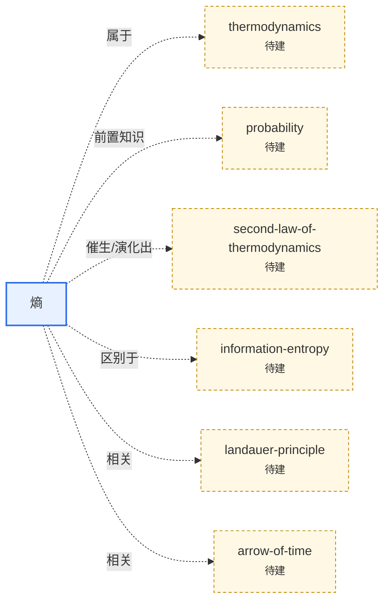

# 🔭 自然科学（`natural-sciences`）

**范围**：物理、化学、天文、地球科学

> 本页上半部分可手写领域导读；`AUTO` 区块由 `python3 tools/kb.py index` 自动维护。

## 条目

<!-- AUTO:START -->
### 概念

- [熵（Entropy）](entropy.md) — 衡量一个系统"有多少种微观方式能实现同一个宏观状态"的物理量；孤立系统的熵不会减少。 `🌳深度`

### 关系图（本领域 + 一跳邻居）

<!-- AUTO:END -->
