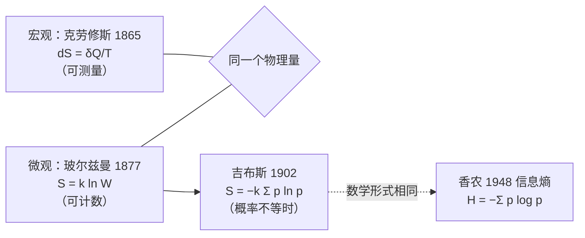

# 熵（Entropy）

<!-- CARD:START -->
> **一句话**：熵衡量的是"有多少种微观方式能实现同一个宏观状态"；孤立系统的熵只增不减，这就是热力学第二定律。
>
> **30 秒版**：一杯水里有天文数字般多的分子，它们的位置和速度可以有无数种排列，而我们看到的"一杯 25℃ 的水"只是一个宏观状态。能实现这个宏观状态的微观排列越多，熵就越大。系统自发地朝"排列方式更多"的状态变化，因为那样的状态压倒性地更可能出现——所以热水会变凉、墨水会散开，而反过来几乎不会发生。

**关键要点**

- 宏观定义（克劳修斯，1865）：可逆过程中 dS = δQ / T，单位焦耳每开尔文（J/K）
- 微观定义（玻尔兹曼）：S = k ln W，W 是微观状态数，k = 1.380649 × 10⁻²³ J/K（2019 年起为精确定义值）
- 第二定律：孤立系统的熵不会减少；熵增是"统计上压倒性地更可能"，不是绝对禁止
- 信息熵（香农，1948）与热力学熵数学形式相同，但一个度量"不确定性"，一个是物理量
- 中文"熵"字是 1923 年胡刚复翻译时造的：dQ/T 是热量与温度之"商"，再加"火"旁

**最常见的误解**：❌ 熵就是"混乱度" → ✅ "混乱"只是比喻，常常误导；更准确的说法是"微观状态数"或"能量分散的程度"
<!-- CARD:END -->

> 📚 **前置知识**：温度与热量、对数、基础概率 ｜ 🎯 **读完你应该能**：用两种方式定义熵；算出冰融化的熵变；解释为什么热量从热传到冷；区分热力学熵与信息熵

---

## 1. 是什么：定义与口径

**权威定义**（宏观与微观两条路线，结论一致）：

> **宏观（经典热力学）**：克劳修斯在 1865 年把热量与温度之比定义为一个新的状态量，并命名为熵，取自希腊语 τροπή（"转变"）[^clausius-ebsco][^clausius-hist]。在可逆过程中：$dS = \delta Q_{rev}/T$。
>
> **微观（统计力学）**：玻尔兹曼在 1877 年的论文中把熵与概率联系起来，通常写作 $S = k\ln W$，其中 $W$ 是与该宏观状态对应的微观状态数[^boltzmann1877]。这个公式刻在维也纳中央公墓玻尔兹曼的墓碑上；一般认为这种现代写法由普朗克写出[^tomb]。

**玻尔兹曼常数**：$k = 1.380649\times10^{-23}$ J/K。2019 年国际单位制修订后，它是 7 个"定义常数"之一，取值是**精确的**[^nist-k]。【共识】

**白话拆解**：

- **宏观状态**：我们能测到的量——温度、压强、体积。
- **微观状态**：每个分子具体在哪、速度多少。
- **熵**：同一个宏观状态背后"藏着"多少种微观状态（取对数再乘以 k）。藏得越多，熵越大。

**口径边界**：

| 语境 | "熵"指什么 | 单位 |
|---|---|---|
| 热力学、统计力学（本条目） | 物理量，系统的状态函数 | J/K |
| 信息论（香农熵） | 概率分布的不确定性 / 平均信息量 | 比特（bit）或纳特（nat） |
| 机器学习 | "交叉熵损失"等，来自信息论 | 无量纲 |
| 日常与人文用法 | "熵增"泛指秩序衰败、趋于混乱 | 无——这是比喻，不是物理量 |

## 2. 为什么：它解决什么问题

**问题：能量守恒解释不了"方向"。** 热力学第一定律说能量守恒，但它不禁止"热量自发从冷水流向热水"——这同样守恒，却从来没人见过。需要一个新的量来刻画**自发过程的方向**，这就是熵。克劳修斯在 1865 年把热力学概括为两句话："宇宙的能量是恒定的；宇宙的熵趋于最大值"[^clausius-ebsco]。

**问题：宏观的不可逆从哪来？** 牛顿力学对时间是对称的，单个分子的运动倒放也合法。玻尔兹曼的回答是：第二定律本质上是**统计规律**——系统趋向平衡，是因为平衡态是压倒性地最可能的状态[^boltzmann1877]。【共识】

**后来的延伸**：信息论借用了同样的数学形式（第 6 节）；薛定谔用"负熵"讨论生命如何维持有序（第 7 节）。

## 3. 怎么运作：机制与结构

### 3.1 宏观：熵是"热量除以温度"的累积

- 可逆过程：$\Delta S = \int \delta Q_{rev}/T$。恒温时简化为 $\Delta S = Q/T$。
- 同样多的热量，在**低温**下引起的熵变更大——这就是热量自发从热流向冷的原因：热端失去的熵 $Q/T_{热}$ 小于冷端得到的熵 $Q/T_{冷}$，总熵增加。
- 第二定律：孤立系统中，可逆过程 $\Delta S = 0$，不可逆过程 $\Delta S > 0$，因此 $\Delta S_{孤立} \ge 0$[^clausius-ebsco]。

### 3.2 微观：数一数有多少种排列

- 玻尔兹曼：$S = k\ln W$[^boltzmann1877]。
- 吉布斯把它推广到微观状态出现概率不相等的情形：$S = -k\sum_i p_i \ln p_i$；当所有可达微观状态等概率（$p_i = 1/W$）时，它退化为玻尔兹曼公式[^gibbs-notes]。吉布斯的系统论述见其 1902 年的《统计力学的基本原理》[^gibbs1902]。
- 为什么熵会增加：宏观上"均匀"的状态对应的微观排列数，远远多于"整齐"的状态（第 5 节有具体数字）。系统在微观状态之间随机游走，几乎必然落入排列数最多的那一类。

### 3.3 两条路线的关系



## 4. 从哪来：起源与演变

| 时间 | 事件 | 来源 |
|---|---|---|
| 1865 | 克劳修斯命名"熵"（希腊语 τροπή，转变），并提出"宇宙的熵趋于最大值" | [^clausius-ebsco][^clausius-hist] |
| 1877 | 玻尔兹曼发表论文，用概率计算解释第二定律，奠定 $S = k\ln W$ 的统计诠释 | [^boltzmann1877] |
| 1902 | 吉布斯出版《统计力学的基本原理》，发展系综方法 | [^gibbs1902] |
| 1923 | 德国学者鲁道夫·普朗克（Rudolf Plank，**不是**量子论的马克斯·普朗克）在南京东南大学演讲，胡刚复任翻译，造出汉字"熵" | [^shang] |
| 1944 | 薛定谔在《生命是什么？》中提出生物"以负熵为食" | [^schrodinger] |
| 1948 | 香农发表《通信的数学理论》，定义信息熵 | [^shannon1948] |
| 1961 / 2012 | 兰道尔提出擦除信息必然散热的下限；2012 年 *Nature* 论文用胶体粒子实验验证 | [^berut2012] |
| 2002 | 兰伯特在《化学教育杂志》撰文批评用"无序"讲授熵 | [^lambert2002] |
| 2019 | 国际单位制修订，玻尔兹曼常数成为精确定义值 | [^nist-k] |

> **演变主线**：热机效率问题（宏观、可测）→ 原子论下的计数（微观、统计）→ 抽象为概率分布的不确定性（信息论）→ 回到物理：信息处理本身有热力学代价。

## 5. 看例子：三个可复算的计算

### 5.1 宏观：1 摩尔冰在 0℃ 融化

冰的摩尔熔化焓 ΔH = 6.01 kJ/mol，熔点 T = 273.15 K[^ice]。恒温恒压相变，可逆：

```
ΔS = ΔH / T = 6010 J/mol ÷ 273.15 K = 22.0 J/(mol·K)
```

与化学教材给出的熔化熵 22.0 J/(K·mol) 一致[^ice]。液态水中分子可以移动和转动，可实现的微观排列远多于冰晶格，所以熵增大。

### 5.2 微观：抛 100 枚硬币

把"正面朝上的硬币个数"当作宏观状态，每枚硬币的正反当作微观状态（共 2¹⁰⁰ ≈ 1.27 × 10³⁰ 种）：

| 宏观状态 | 微观状态数 W | ln W |
|---|---|---|
| 100 枚全正面 | 1 | 0 |
| 60 正 40 反 | C(100,60) ≈ 1.37 × 10²⁸ | 64.8 |
| 50 正 50 反 | C(100,50) ≈ 1.01 × 10²⁹ | 66.8 |

随机抛一次，落在 40–60 枚正面之间的概率约 **96.5%**；全部正面的概率是 1/2¹⁰⁰ ≈ 7.9 × 10⁻³¹。真实物体的粒子数是 10²³ 量级，差距会大到"不可逆"在实际上等同于"不可能逆转"——这就是统计意义上的第二定律。（本节数字为本条目自行计算）

### 5.3 信息：硬币与骰子的香农熵

用 $H = -\sum p\log_2 p$（单位：比特）：

```
公平硬币   H = −(0.5·log₂0.5 + 0.5·log₂0.5) = 1 比特
偏心硬币(0.9/0.1)  H = −(0.9·log₂0.9 + 0.1·log₂0.1) ≈ 0.469 比特
公平骰子   H = log₂6 ≈ 2.585 比特
```

越难预测，熵越大；完全确定（概率为 1）时熵为 0[^d2l-entropy]。

**连接两者**：兰道尔极限——在温度 T 下擦除 1 比特信息，至少散发 $kT\ln2$ 的热量[^berut2012]。室温 300 K 时：

```
kT ln2 = 1.380649×10⁻²³ × 300 × 0.6931 ≈ 2.87 × 10⁻²¹ J
```

## 6. 别搞混：辨析与误区

| 对比对象 | 相同点 | 关键区别 |
|---|---|---|
| 信息熵（香农熵） | 数学形式与吉布斯熵相同：$-\sum p\log p$ | 信息熵度量概率分布的不确定性，单位比特，可用于任何概率分布；热力学熵是物理系统的状态函数，单位 J/K。两者通过兰道尔原理产生物理联系[^shannon1948][^berut2012] |
| 能量 | 都是状态函数，都出现在热力学定律中 | 能量守恒（第一定律）；熵在孤立系统中不减（第二定律） |
| "混乱度" | 很多情况下熵大的状态看起来更"乱" | "混乱"是视觉比喻，不是定义；有些自发过程看起来更"有序"，总熵仍在增加（见下） |
| 日常/人文中的"熵增" | 都借用"趋向衰败"的意象 | 物理的熵增只对**孤立系统**成立；公司、个人、社会都是开放系统，"熵增定律"在这些语境中是比喻 |

**常见误区**

- ❌ 熵就是混乱度 → ✅ 兰伯特指出，"无序"作为讲授熵的拐杖是"一根有裂缝的拐杖"，建议从**能量分散**的角度理解[^lambert2002]。例：过冷水结冰看起来"更有序"，但放出的热量让环境熵增加得更多，总熵仍增加。
- ❌ 熵永远不能减少 → ✅ 只有**孤立系统**的总熵不减；冰箱内部、生物体内的熵都可以减少，代价是向外界排出更多熵。
- ❌ 发明"熵"字的是量子论的马克斯·普朗克来华讲学 → ✅ 1923 年来华演讲的是德国学者鲁道夫·普朗克（Rudolf Plank），翻译者胡刚复造了"熵"字[^shang]。
- ❌ 第二定律说"不可能"逆转 → ✅ 它是统计规律：逆转的概率不为零，只是对宏观系统小到可以忽略（第 5.2 节）。

## 7. 怎么看：多方视角与争议

| 议题 | 观点 | 依据 |
|---|---|---|
| 熵该怎么讲 | **"无序"派**：直观、易记，在高级讨论中可谨慎使用 | 兰伯特本人也承认它对玻尔兹曼等人曾有帮助[^lambert2002] |
| | **"能量分散"派**：初学者应避免"无序"，改讲能量如何分散 | 兰伯特 2002[^lambert2002] |
| | **"微观状态数/信息"派**：熵就是对微观状态缺失信息的度量 | 由吉布斯熵与香农熵的同构而来[^gibbs-notes][^shannon1948]（这一诠释在物理学界有支持也有保留意见【争议】） |
| 香农为何叫它"熵" | 据转述，冯·诺依曼建议香农用"熵"这个名字，理由之一是"没人真正知道熵是什么，辩论时你总占上风" | 出自 Tribus 与 McIrvine 1971 年《科学美国人》文章的转述，属二手记载[^tribus] |
| 熵与生命 | 薛定谔：生物"以负熵为食"，从环境中汲取秩序 | 《生命是什么？》1944[^schrodinger]；后人指出"负熵"并非严格的热力学术语，但思想预见了"生命是远离平衡的开放系统"的现代观点[^schrodinger] |

- **共识**：熵的宏观与统计定义等价；第二定律适用于孤立系统；它是统计规律。【共识】
- **分歧**：最佳的教学比喻；信息诠释在多大程度上是"物理的"。【争议】

## 8. 怎么用：应用与启发

**科学与工程**

- **热机与制冷**：熵决定了任何热机效率的上限，也决定了冰箱、空调至少要耗多少功。
- **化学反应方向**：吉布斯自由能 ΔG = ΔH − TΔS 判断反应能否自发进行（例：0℃ 以上冰会融化，因为 TΔS 项超过了 ΔH）。
- **信息与计算**：数据压缩的极限由信息熵决定[^d2l-entropy]；兰道尔原理给出计算能耗的物理下限[^berut2012]。
- **机器学习**：交叉熵损失来自信息熵[^d2l-entropy]——注意它与热力学熵是"同名不同物"。

**思维与生活（比喻层面，需要知道它是比喻）**

- 维持任何有序结构（整洁的房间、健康的身体、运转的组织）都需要持续输入能量——这是"开放系统要靠外部能量抵消熵增"的类比。
- 看到"熵增定律告诉我们……"式的人生建议时，先问：这是孤立系统吗？类比在哪里失效？

## 9. 自测

<details><summary>Q1. 用一句话分别给出熵的宏观定义和微观定义。</summary>

答：宏观：可逆过程中吸收的热量除以绝对温度的累积，dS = δQ_rev/T；微观：S = k ln W，W 是实现该宏观状态的微观状态数。（第 1、3 节）
</details>

<details><summary>Q2. 为什么热量会自发地从热物体流向冷物体？请用熵解释。</summary>

答：同样的热量 Q，在低温物体上引起的熵增 Q/T冷 大于在高温物体上引起的熵减 Q/T热，所以热→冷的传递使总熵增加，是自发的；反方向会使总熵减少，孤立系统中不会自发发生。（第 3.1 节）
</details>

<details><summary>Q3. 冰箱让内部变冷、熵减少，这违反第二定律吗？</summary>

答：不违反。第二定律针对孤立系统。冰箱消耗电能，把热量排到房间里，房间（环境）增加的熵大于冰箱内部减少的熵，总熵仍然增加。（第 6 节）
</details>

<details><summary>Q4. 信息熵和热力学熵是同一个东西吗？它们有什么联系？</summary>

答：不是同一个东西：信息熵度量概率分布的不确定性（比特），热力学熵是物理系统的状态函数（J/K）。它们的数学形式相同（吉布斯熵与香农熵），并通过兰道尔原理产生物理联系：擦除 1 比特信息至少散热 kT ln2。（第 5.3、6 节）
</details>

<details><summary>Q5. 为什么说"熵 = 混乱度"是一个容易误导的说法？举一个反例。</summary>

答：混乱是视觉比喻而非定义。反例：过冷水结冰，冰晶看起来更有序，系统自身熵减少，但放出的热使环境熵增加更多，总熵增加。兰伯特建议从能量分散的角度理解。（第 6 节）
</details>

<details><summary>Q6.（计算）1 摩尔水在 100℃（373.15 K）汽化，汽化焓约 40.7 kJ/mol。熵变约为多少？为什么比熔化熵大得多？</summary>

答：ΔS = 40700 / 373.15 ≈ 109 J/(mol·K)，约为熔化熵（22.0）的 5 倍。气体分子可以在大得多的空间中运动，可实现的微观状态数远多于液体。（汽化焓为题目给定的示意数值，计算方法同第 5.1 节）
</details>

## 10. 关联

<!-- RELATIONS:START -->
**出链**（本条 → 其他）

- **属于** → `thermodynamics` 〔待建〕：热力学的核心状态函数
- **前置知识** → `probability` 〔待建〕：统计诠释要用到概率与计数
- **催生/演化出** → `second-law-of-thermodynamics` 〔待建〕：熵是表述第二定律的核心量
- **区别于** → `information-entropy` 〔待建〕：香农熵：数学形式相同，研究对象不同
- **相关** → `landauer-principle` 〔待建〕：擦除信息的最低热耗散，连接信息与热力学
- **相关** → `arrow-of-time` 〔待建〕：熵增常被用来解释时间为何有方向

> 学习路径：`python3 tools/kb.py path entropy` ｜ 一跳邻居：`python3 tools/kb.py neighbors entropy`
<!-- RELATIONS:END -->

## 11. 来源

> 检索覆盖：学术论文与原始文献 / 官方计量机构 / 教材 / 科学史 / 中文科普 / 批评与反方（"无序"之争）；语种：中文、英文。
> 未能访问：斯坦福哲学百科、不列颠百科、维基百科、兰伯特个人网站等在本环境无法直接打开，相关内容依据检索摘要核实；《动手学深度学习》通过 GitHub 源文件阅读全文。

[^clausius-ebsco]: **S2** · EBSCO Research Starters, *Clausius and the Second Law of Thermodynamics* · <https://www.ebsco.com/research-starters/history/clausius-and-second-law-thermodynamics/> · 核实：摘要 · 访问 2026-10-06 · 支撑：1865 年命名熵、词源"转变"；"宇宙的能量恒定，宇宙的熵趋于最大值"；孤立系统 ΔS ≥ 0
[^clausius-hist]: **S3** · 维基百科 *History of entropy* / *Entropy* 条目（经检索摘要） · <https://en.wikipedia.org/wiki/History_of_entropy> · 核实：摘要 · 访问 2026-10-06 · 支撑：克劳修斯原话"I propose to call the magnitude S the entropy of the body, from the Greek word τροπή, transformation"（与上一来源相互印证）
[^boltzmann1877]: **S1** · Boltzmann, L. (1877), *Über die Beziehung zwischen dem zweiten Hauptsatze der mechanischen Wärmetheorie und der Wahrscheinlichkeitsrechnung…*, Wien. Ber. 76:373–435；英译 Sharp & Matschinsky, *Entropy* 17(4):1971, 2015 · <https://www.mdpi.com/1099-4300/17/4/1971> · 核实：摘要 · 访问 2026-10-06 · 支撑：概率诠释；S = k log W；平衡态是压倒性最可能的状态
[^tomb]: **S3** · 关于玻尔兹曼墓碑与公式写法的多个检索结果（如 ResearchGate 图片说明、科学史博客） · <https://www.researchgate.net/figure/Tombstone-of-Ludwig-Boltzmann-in-Vienna-showing-his-fundamental-formula-Sk-log-W-where_fig9_310428923> · 核实：摘要 · 访问 2026-10-06 · 支撑：公式刻于维也纳中央公墓墓碑；现代写法一般认为由普朗克写出
[^nist-k]: **S1** · NIST, *Kelvin: Boltzmann Constant*（SI 重新定义） · <https://www.nist.gov/si-redefinition/kelvin/kelvin-boltzmann-constant> · 核实：摘要 · 访问 2026-10-06 · 支撑：k = 1.380649×10⁻²³ J/K 为 2019 年 SI 修订后的精确定义值
[^gibbs1902]: **S1** · Gibbs, J. W., *Elementary Principles in Statistical Mechanics*, 1902（剑桥大学出版社重印 ISBN 9781108017022） · <https://en.wikipedia.org/wiki/Elementary_Principles_in_Statistical_Mechanics> · 核实：摘要 · 访问 2026-10-06 · 支撑：1902 年出版；现代统计力学的奠基之作；系综方法
[^gibbs-notes]: **S2** · Schwartz, M., *Statistical Mechanics Lecture 6: Entropy*, 哈佛大学课程讲义 2019 · <https://scholar.harvard.edu/files/schwartz/files/6-entropy.pdf> · 核实：摘要 · 访问 2026-10-06 · 支撑：吉布斯熵公式；等概率时退化为玻尔兹曼公式
[^shannon1948]: **S1** · Shannon, C. E., *A Mathematical Theory of Communication*, Bell System Technical Journal 27(3):379–423 & 27(4):623–656, 1948 · <https://archive.org/details/bstj27-3-379> · 核实：摘要 · 访问 2026-10-06 · 支撑：信息熵的提出；与统计力学熵形式相似；"比特"进入科学用语
[^d2l-entropy]: **S1** · 阿斯顿·张、扎卡里·C. 立顿、李沐、亚历山大·J. 斯莫拉，《动手学深度学习》3.4 节"softmax 回归 · 信息论基础"（教材） · <https://github.com/d2l-ai/d2l-zh/blob/master/chapter_linear-networks/softmax-regression.md> · 核实：全文 · 访问 2026-10-06 · 支撑：信息熵公式；纳特与比特的换算；信息量 −log P 即"惊异"；交叉熵的含义
[^berut2012]: **S1** · Bérut, A. et al., *Experimental verification of Landauer's principle linking information and thermodynamics*, Nature 483:187–189, 2012 · <https://www.nature.com/articles/nature10872> · 核实：摘要 · 访问 2026-10-06 · 支撑：擦除 1 比特的最小散热（兰道尔极限）；实验验证
[^lambert2002]: **S1** · Lambert, F. L., *Disorder—A Cracked Crutch for Supporting Entropy Discussions*, Journal of Chemical Education 79:187–192, 2002 · <https://franklambert.net/jce/lambert2002.pdf> · 核实：摘要 · 访问 2026-10-06 · 支撑：反对用"无序"讲授熵；主张能量分散视角
[^schrodinger]: **S1** · Schrödinger, E., *What Is Life? The Physical Aspect of the Living Cell*, 1944（及 PMC 综述 *Answering Schrödinger's "What Is Life?"*） · <https://pmc.ncbi.nlm.nih.gov/articles/PMC7517386/> · 核实：摘要 · 访问 2026-10-06 · 支撑："负熵"概念的提出；后人对其严格性的评价
[^tribus]: **S3** · 转引自多份讲义与讨论（原始出处：Tribus, M. & McIrvine, E. C., *Energy and Information*, Scientific American 224, 1971） · <https://en.wikipedia.org/wiki/Talk:History_of_entropy> · 核实：转引 · 访问 2026-10-06 · 支撑：冯·诺依曼建议香农使用"熵"一词的轶事（二手记载）
[^shang]: **S2** · 返朴《"熵"字的由来》（澎湃新闻·湃客转载） · <https://www.thepaper.cn/newsDetail_forward_20422926> · 核实：摘要 · 访问 2026-10-06 · 支撑：1923 年鲁道夫·普朗克（Rudolf Plank）来华在东南大学演讲，胡刚复翻译并依"热量与温度之商 + 火"造"熵"字
[^ice]: **S1** · Brown, T. L. et al., *Chemistry: The Central Science*（第 14 版）第 18 章习题及多份化学教学资料 · <https://www.pearson.com/channels/general-chemistry/textbook-solutions/brown-14th-edition-978-0134414232/ch18-chemistry-of-the-environment/the-enthalpy-of-fusion-of-water-is-6-01-kj-mol-sunlight-striking-earth-s-surface> · 核实：摘要 · 访问 2026-10-06 · 支撑：冰的熔化焓 6.01 kJ/mol；273.15 K 时熔化熵 22.0 J/(K·mol)

## 12. 我的思考

> 留白，只由仓库主人填写。引导问题：
> - 我以前是怎么理解"熵增"的？哪一点被修正了？
> - 在我常听到的"熵增定律"人生建议里，哪些类比是成立的，哪些在第 6 节的意义上失效了？
> - 信息熵和热力学熵的联系，最让我意外的是什么？

## 变更记录

- 2026-10-06 创建（深度级）。第 5 节数字均为本条目自行计算；Q6 的汽化焓为示意数值。
