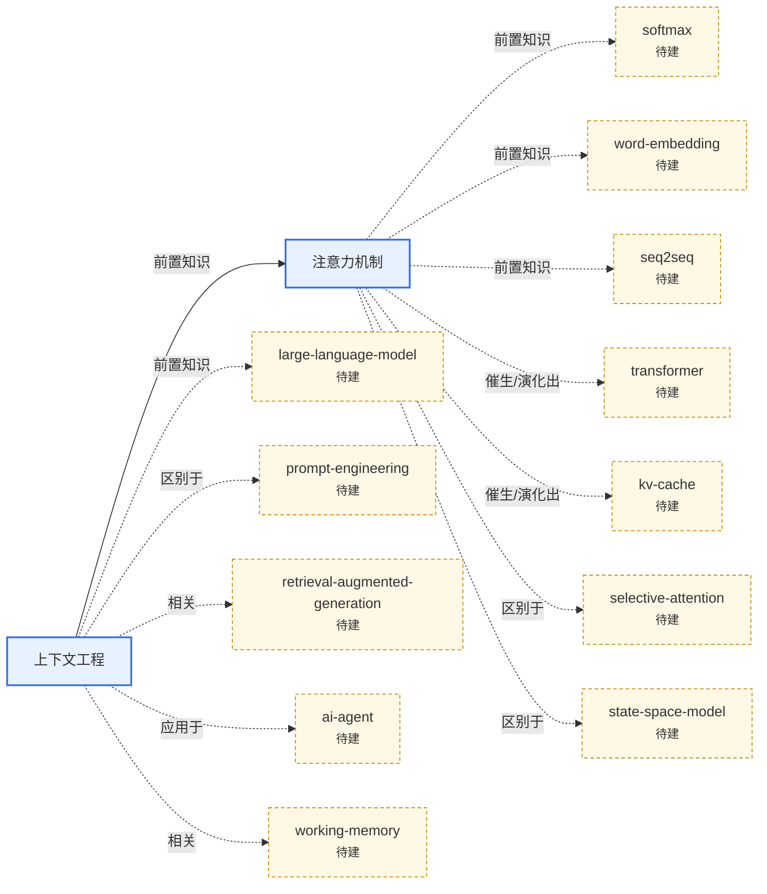

# 🤖 技术与 AI（`tech-ai`）

**范围**：计算机、人工智能、互联网、电子与工程技术

> 本页上半部分可手写领域导读；`AUTO` 区块由 `python3 tools/kb.py index` 自动维护。

## 条目

<!-- AUTO:START -->
### 概念

- [注意力机制（Attention Mechanism）](attention-mechanism.md) — 按"相关程度"给所有输入分配权重再加权求和的神经网络机制，是 Transformer 与大模型的核心。 `🌳深度`
- [上下文工程（Context Engineering）](context-engineering.md) — 为大模型的每一步推理挑选、组织、压缩"恰好够用"的上下文信息的工程方法。 `🌳深度`

### 关系图（本领域 + 一跳邻居）

<!-- AUTO:END -->
