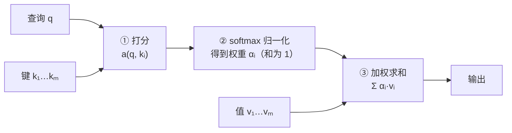

# 注意力机制（Attention Mechanism）

<!-- CARD:START -->
> **一句话**：让模型在处理每个位置时，按"相关程度"给所有输入打分、把分数变成权重，再对输入做加权求和——相关的多看，无关的少看。
>
> **30 秒版**：早期的翻译模型要先把整句话压缩成一个固定长度的向量，句子一长就记不住。注意力换了个思路：每生成一个词，都回头给输入的每个位置打个"相关分"，用 softmax 把分数变成加起来等于 1 的权重，再按权重混合各位置的信息。2017 年的 Transformer 把它变成了整个模型的核心，今天的大语言模型几乎都建立在它之上。

**关键要点**

- 核心公式：Attention(Q, K, V) = softmax(QKᵀ / √d_k) · V —— 查询 Q 与键 K 算相关性，权重作用在值 V 上
- 它是"软"选择：不是只挑一个，而是所有位置按权重混合
- 自注意力：Q、K、V 来自同一序列；交叉注意力：Q 来自一方，K、V 来自另一方
- 代价：计算量随序列长度 n 按 n² 增长，这是长上下文昂贵的根源；FlashAttention、GQA、MLA 等技术都在缓解它
- 注意力权重能不能当作模型的"理由"，学界有争议

**最常见的误解**：❌ 注意力就是模型像人一样"专注" → ✅ 它是一种可学习的加权平均，名字借自心理学，机制完全不同
<!-- CARD:END -->

> 📚 **前置知识**：向量与点积、softmax 函数、词向量（embedding）、编码器-解码器的基本概念 ｜ 🎯 **读完你应该能**：手算一次注意力；解释为什么要除以 √d_k；说清自注意力与交叉注意力的区别；理解长上下文为什么又贵又不一定准

---

## 1. 是什么：定义与口径

**权威定义**（两个来源交叉）：

> 注意力汇聚的计算分三步：用**评分函数**计算查询与每个键的相关性，经 **softmax** 得到与键对应的值的概率分布（即注意力权重），最后输出这些**值的加权和**；由于权重是概率分布，这个加权和本质上是加权平均。——《动手学深度学习》第 10 章[^d2l]
>
> Transformer 原论文提出的缩放点积注意力：$\mathrm{Attention}(Q,K,V)=\mathrm{softmax}\!\left(\frac{QK^\top}{\sqrt{d_k}}\right)V$[^vaswani2017]【共识】

**白话拆解**：

| 角色 | 英文 | 它是什么 | 类比（查资料） |
|---|---|---|---|
| 查询 | Query（Q） | "我现在需要什么信息" | 你手里的问题 |
| 键 | Key（K） | "我这里有什么信息"的标签 | 每本书的索引卡 |
| 值 | Value（V） | 真正被取走的内容 | 书里的正文 |
| 注意力权重 | Attention weights | 问题与每张索引卡的匹配度，归一化后和为 1 | 你决定从每本书里摘抄多少 |

> **类比的失效边界**：真实的注意力不会"只挑一本书"，而是对**所有**书按权重混合摘抄；而且问题、索引卡、正文都是模型从数据中学出来的向量（由输入乘以可学习的矩阵得到），不是人定义的。

**口径边界**：

- **广义**：任何"用查询对一组键值对打分、归一化、加权求和"的机制，包括加性注意力、点积注意力、缩放点积注意力等[^d2l]。
- **狭义（今天最常见的用法）**：Transformer 中的**缩放点积多头注意力**[^vaswani2017]。
- **不包括**：认知心理学中人的注意力（见第 6 节）；"注意力经济"中的注意力。
- **常见变体**：自注意力（self-attention，也叫内部注意力 intra-attention）、交叉注意力（编码器-解码器注意力）、掩蔽注意力（masked attention）[^d2l]。

## 2. 为什么：它解决什么问题

**问题一：固定长度瓶颈。** 2014 年前后主流的神经机器翻译用"编码器-解码器"结构：编码器把整句源语言压成一个**固定长度**的向量，解码器只靠它生成译文。Bahdanau 等人指出这个固定长度向量是性能瓶颈，提出让模型在生成每个词时**自动"搜索"源句中相关的部分**——这就是注意力在机器翻译中的起点[^bahdanau2014]。【共识】

**问题二：长距离依赖与并行。** 循环神经网络（RNN）必须一个词一个词地顺序处理，相隔很远的两个词之间的信息要经过很多步传递。自注意力让任意两个位置一步直连。《动手学深度学习》对三种架构的比较（n 为序列长度，d 为向量维度，k 为卷积核大小）[^d2l]：

| 架构 | 每层计算复杂度 | 顺序操作数（越少越能并行） | 最大路径长度（越短越易学远距离依赖） |
|---|---|---|---|
| 卷积神经网络 | O(k·n·d²) | O(1) | O(n/k) |
| 循环神经网络 | O(n·d²) | O(n) | O(n) |
| **自注意力** | **O(n²·d)** | **O(1)** | **O(1)** |

结论：自注意力路径最短、可完全并行——代价是计算量对序列长度呈**二次方**增长，长序列会很慢[^d2l][^vaswani2017]。【共识】这个代价贯穿了注意力此后的全部发展史（见第 4、7 节）。

## 3. 怎么运作：机制与结构

### 3.1 三步走：打分 → 归一化 → 加权求和



第①步的"评分函数"有几种主要选择[^d2l][^luong2015]：

| 评分函数 | 公式 | 出处与特点 |
|---|---|---|
| 加性注意力 | $a(q,k)=w_v^\top\tanh(W_q q+W_k k)$ | Bahdanau 等（2014）；把查询和键送进一个单隐藏层的小网络；查询与键长度可以不同 |
| 点积注意力 | $a(q,k)=q^\top k$ | Luong 等（2015）比较了 dot / general / concat 等多种打分方式；计算快 |
| **缩放点积注意力** | $a(q,k)=q^\top k/\sqrt{d}$ | Transformer（2017）；今天的事实标准 |

### 3.2 为什么要除以 √d_k

Transformer 原论文的解释：当维度 $d_k$ 较大时，点积的数值会变得很大，把 softmax 推入**梯度极小**的区域，因此用 $1/\sqrt{d_k}$ 缩放[^vaswani2017]。背后的统计直觉是：若查询和键的各分量是相互独立、均值 0、方差 1 的随机变量，它们的点积均值为 0、**方差为 $d_k$**；除以 $\sqrt{d_k}$ 后方差回到 1[^vaswani2017][^d2l]。【共识】

数字直观（本条目自行计算，示意）：假设三个键的打分恰好是"一个标准差"量级，即 $[\sqrt{d},\,0,\,-\sqrt{d}]$，不缩放时 softmax 的结果：

| 维度 d | 分数 | 最大权重 | 该权重对自身分数的梯度 $w(1-w)$ |
|---|---|---|---|
| 2 | [1.41, 0, −1.41] | 0.768 | 0.178 |
| 64 | [8, 0, −8] | ≈ 0.9997 | 3.4 × 10⁻⁴ |
| 512 | [22.6, 0, −22.6] | ≈ 1 | 1.5 × 10⁻¹⁰ |

维度越高，权重越接近"非 0 即 1"，梯度几乎消失，模型就学不动了。

### 3.3 多头注意力

与其只做一次注意力，不如把 Q、K、V 用 $h$ 组**独立学习的线性投影**映射到不同的子空间，并行做 $h$ 次注意力，再把结果拼接、线性变换——每一组叫一个"头"[^d2l]。不同的头可以学到不同类型的关系（例如短距离与长距离依赖）[^d2l]。

Transformer 基础模型的配置：$h=8$ 个头，$d_{model}=512$，每个头 $d_k=d_v=d_{model}/h=64$；由于每个头的维度降低了，总计算量与单头全维度注意力相近[^vaswani2017]。【共识】

### 3.4 三种用法：Q、K、V 从哪里来

| 类型 | 查询 Q 来自 | 键 K、值 V 来自 | 用在哪 |
|---|---|---|---|
| 自注意力 | 本序列 | 本序列 | 编码器各层；让每个词"看"同一句里的其他词 |
| 交叉注意力（编码器-解码器注意力） | 解码器上一层的输出 | 编码器的输出 | 翻译等"看着原文写译文"的任务 |
| 掩蔽（因果）自注意力 | 本序列 | 本序列中**当前位置及之前**的部分 | 解码器/GPT 类模型；保证生成时只依赖已生成的词（自回归） |

以上三种用法均见于 Transformer 的编码器-解码器结构[^d2l]。另外，自注意力本身**不感知顺序**，需要额外加入**位置编码**注入位置信息[^d2l]。

### 3.5 推理时的 KV 缓存：显存瓶颈从哪来

大模型逐词生成时，每个新词都要和之前所有词做注意力。为避免重复计算，系统会把之前各层的 K 和 V 缓存起来——这就是 **KV 缓存**。它的大小随上下文长度**线性增长**。

估算公式（标准多头注意力）：每个 token 的 KV 缓存 = 2（K 和 V）× 层数 × 头数 × 每头维度 × 每个数的字节数。

以 Llama 2 7B 为例（32 层、32 个头、隐藏维度 4096、每头 128 维[^llama2cfg]），用 16 位浮点（2 字节）存储：

```
每 token：2 × 32 层 × 4096 × 2 字节 = 524,288 字节 = 0.5 MiB
4096 个 token：0.5 MiB × 4096 = 2 GiB      ← 仅一条对话的缓存
```

这就是为什么会出现以下优化：**多查询注意力 MQA**（所有头共享一组 K、V）[^shazeer2019]、**分组查询注意力 GQA**（若干个头共享一组 K、V，质量接近多头、速度接近 MQA）[^gqa2023]、**多头潜在注意力 MLA**（把 KV 压缩进低维潜在向量，DeepSeek-V2 报告相比 DeepSeek 67B 的 KV 缓存减少 93.3%）[^deepseekv2]。

## 4. 从哪来：起源与演变

| 时间 | 事件 | 来源 |
|---|---|---|
| 1890 年代 | 心理学家威廉·詹姆斯提出注意力的"双组件"框架（非自主性提示 vs 自主性提示）；《动手学深度学习》用它类比"键"与"查询" | [^d2l] |
| 1964 | Nadaraya-Watson 核回归：后来被教材视为"注意力汇聚"的一个简单而完整的早期例子（属后见之明的解读） | [^d2l] |
| 2013 | Graves 在手写体生成中设计了可微的注意力，将文本字符与笔迹对齐（只能单向移动） | [^d2l] |
| 2014 | Bahdanau、Cho、Bengio 提出用于机器翻译的注意力（加性注意力），突破固定长度瓶颈；2015 年发表于 ICLR | [^bahdanau2014] |
| 2015 | Luong 等提出全局/局部注意力，局部注意力比无注意力系统高 5.0 BLEU（EMNLP） | [^luong2015] |
| 2015 | Xu 等《Show, Attend and Tell》把注意力用于看图说话，区分软注意力与硬注意力（ICML） | [^xu2015] |
| 2017 | Vaswani 等提出 Transformer，"完全基于注意力"，抛弃循环与卷积；英德翻译 28.4 BLEU、英法 41.8 BLEU（8 块 GPU 训练 3.5 天） | [^vaswani2017] |
| 2019 | Shazeer 提出多查询注意力（MQA），降低增量解码的显存带宽需求 | [^shazeer2019] |
| 2019 | "注意力是不是解释"之争：Jain & Wallace（NAACL）与 Wiegreffe & Pinter（EMNLP） | [^jain2019][^wiegreffe2019] |
| 2020 | 线性注意力：把复杂度从 O(N²) 降到 O(N)（ICML） | [^katharopoulos2020] |
| 2022 | FlashAttention：不做近似、通过分块减少显存读写，最高约 3 倍加速 | [^flash2022] |
| 2023 | 分组查询注意力 GQA（EMNLP）；Mamba 提出不用注意力的选择性状态空间模型 | [^gqa2023][^mamba2023] |
| 2024 | 发现"注意力汇聚点"（attention sink）现象，据此实现流式长文本推理（ICLR）；DeepSeek-V2 提出 MLA | [^xiao2024][^deepseekv2] |

> **演变主线**：心理学隐喻 → 翻译模型里的"对齐"配件（附着在 RNN 上）→ 整个架构的核心（Transformer）→ 围绕 n² 计算量与 KV 显存的工程优化 → 与线性时间替代路线的竞争与混合。

## 5. 看例子：手算一次注意力

**设定**（示意数字）：有 3 个词元 A、B、C，维度 $d=2$。当前查询与各键、值如下：

```
查询 q   = [1, 0]
键   k_A = [1, 0]    值 v_A = [10, 0]
     k_B = [0, 1]       v_B = [0, 10]
     k_C = [1, 1]       v_C = [5, 5]
```

**① 打分**（点积）：q·k_A = 1，q·k_B = 0，q·k_C = 1 → `[1, 0, 1]`

**② 缩放**（除以 √2 ≈ 1.4142）：`[0.7071, 0, 0.7071]`

**③ softmax**：

```
e^0.7071 = 2.0281，e^0 = 1，e^0.7071 = 2.0281，合计 5.0562
权重 = [2.0281/5.0562, 1/5.0562, 2.0281/5.0562] = [0.4011, 0.1978, 0.4011]   （和为 1）
```

**④ 加权求和**：

```
输出 = 0.4011×[10,0] + 0.1978×[0,10] + 0.4011×[5,5]
     = [4.011 + 0 + 2.006,  0 + 1.978 + 2.006]
     = [6.017, 3.983]
```

**读数**：与查询最匹配的 A、C 各拿到约 40% 的权重，不太相关的 B 也拿到约 20%——这就是"软"选择：没有哪个位置被完全忽略。如果不做缩放，权重会变成 `[0.4223, 0.1554, 0.4223]`，分布更"尖"；维度越高，这种变尖越严重（见 3.2 节的表）。

**放到真实模型里**：在"小猫没有喝牛奶，因为**它**不渴"这样的句子中，"它"这个位置的查询会与"小猫"的键得到较高匹配，于是"它"的新表示里混入了更多"小猫"的信息——这是理解自注意力作用的常用直观示意（示意例句，不代表任何具体模型的实测权重）。

## 6. 别搞混：辨析与误区

| 对比对象 | 相同点 | 关键区别 |
|---|---|---|
| 认知心理学的注意力 | 都涉及"有选择地处理信息" | 心理学的注意力是人脑的认知过程；机器学习的注意力是一个可微的加权平均运算。教材借用前者做类比[^d2l]，但两者并非同一机制 |
| Transformer | Transformer 以注意力为核心 | 注意力是一个**组件**；Transformer 是一个**架构**，还包括前馈网络、残差连接、层规范化、位置编码等[^d2l] |
| 自注意力 vs 交叉注意力 | 计算公式相同 | 区别只在 Q、K、V 的来源（见 3.4 节）[^d2l][^zhihu-self-cross] |
| 软注意力 vs 硬注意力 | 都在挑选输入的一部分 | 软注意力对所有位置加权混合、可直接求导；硬注意力只选一部分[^xu2015] |
| 注意力权重 vs 特征重要性 | 都像是在说"模型看重什么" | 两者可能不一致，能否把权重当作解释存在争议（见第 7 节）[^jain2019][^wiegreffe2019] |

**常见误区**

- ❌ 注意力是 Transformer 发明的 → ✅ 2014 年就已用于机器翻译[^bahdanau2014]；Transformer 的创新在于"**只用**注意力"，抛弃循环与卷积[^vaswani2017]。
- ❌ 注意力只挑最相关的那一个 → ✅ 标准（软）注意力是对所有位置的加权混合（见第 5 节的例子）。
- ❌ 上下文窗口越大，模型就能同样好地利用全部内容 → ✅ 实验表明相关信息位于长上下文中间时，模型表现明显下降[^lim]。窗口大小是"能装多少"，不等于"能用好多少"。
- ❌ 注意力权重高的词就是模型做决定的依据 → ✅ 这是一个有争议的推断，不能直接成立（见第 7 节）。

## 7. 怎么看：多方视角与争议

| 议题 | 观点 | 依据 |
|---|---|---|
| 注意力能否当解释 | **否定派**：在多种任务上，注意力权重常与基于梯度的特征重要性不相关；还能构造出差异很大、预测却相同的注意力分布 | Jain & Wallace 2019[^jain2019] |
| | **修正派**：上述结论依赖于"解释"的定义与实验设计；在恰当的设定下，注意力可以提供有意义的解释 | Wiegreffe & Pinter 2019[^wiegreffe2019] |
| 如何降低 n² 成本 | **保留精确注意力、优化实现**：FlashAttention 不做近似，通过分块减少 GPU 显存读写 | Dao 等 2022[^flash2022] |
| | **压缩 KV**：MQA、GQA、MLA | [^shazeer2019][^gqa2023][^deepseekv2] |
| | **改写注意力本身**：线性注意力把复杂度降到 O(N)，并揭示它与 RNN 的联系 | Katharopoulos 等 2020[^katharopoulos2020] |
| | **不用注意力**：Mamba 认为此前的次二次方模型在语言等重要模态上不如注意力，并提出选择性状态空间模型，报告推理吞吐约为 Transformer 的 5 倍、对序列长度线性扩展 | Gu & Dao 2023（预印本）[^mamba2023] |
| 长上下文中注意力的"偏好" | 模型对开头与结尾的信息利用更好；模型会把多余的注意力"倾倒"在开头的几个词元上（attention sink） | [^lim][^xiao2024] |

- **共识**：缩放点积多头注意力是当前主流大模型的核心组件——连提出替代方案的 Mamba 论文也承认，基础模型"几乎普遍"基于 Transformer 及其注意力模块[^mamba2023]；n² 计算量与 KV 缓存是真实的工程瓶颈。【共识】
- **分歧**：注意力权重的解释力【争议】；未来架构是纯注意力、替代路线还是混合【争议】。

## 8. 怎么用：应用与启发

**理解 AI 的行为**

- 长提示又贵又慢：计算量随长度二次方增长，KV 缓存随长度线性增长（第 2、3.5 节）。
- 长提示不一定更准：相关信息放在开头或结尾更容易被用好，无关内容会干扰（第 6 节）。这正是本仓库"分层加载、按需关联"设计的依据，详见 [system/ARCHITECTURE.md](../../system/ARCHITECTURE.md)。

**给 AI 写提示时**

1. 把最关键的指令和材料放在开头或结尾；
2. 删掉与问题无关的上下文，而不是"多给点总没错"；
3. 资料很多时，先检索出相关片段再交给模型（按需加载）。

**工程估算**：用 3.5 节的公式估算 KV 缓存显存，判断能支持多长的上下文、多少并发；选型时关注模型是否使用 GQA/MLA、推理框架是否支持 FlashAttention。

**深入学习的路线**：《动手学深度学习》第 10 章（有中文版，含可运行代码）[^d2l] → Transformer 原论文[^vaswani2017] → 本条目第 7 节的高效注意力论文。

## 9. 自测

<details><summary>Q1. 缩放点积注意力为什么要除以 √d_k？如果不除会怎样？</summary>

答：若查询和键的分量独立、均值 0、方差 1，点积的方差等于 d_k。维度大时点积数值大，softmax 输出接近"非 0 即 1"，梯度极小，训练困难。除以 √d_k 把方差拉回 1。（第 3.2 节）
</details>

<details><summary>Q2. 自注意力、交叉注意力、掩蔽自注意力的区别是什么？</summary>

答：公式相同，区别在 Q、K、V 的来源与可见范围：自注意力三者都来自同一序列；交叉注意力的 Q 来自解码器、K/V 来自编码器；掩蔽自注意力只允许看当前位置及之前的内容，以保证自回归生成。（第 3.4 节）
</details>

<details><summary>Q3. 注意力最初是为了解决机器翻译中的什么问题？</summary>

答：编码器-解码器结构要把整句源语言压缩进一个固定长度向量，句子越长信息损失越严重。注意力让解码器在生成每个词时回看源句的所有位置，按相关性取用信息。（第 2 节）
</details>

<details><summary>Q4. 为什么说自注意力"擅长长距离依赖，但不擅长长序列"？这两句话矛盾吗？</summary>

答：不矛盾。任意两个位置之间只需一步（最大路径长度 O(1)），所以容易建模远距离关系；但每层要计算 n×n 个位置对（计算量 O(n²·d)），序列一长，计算和显存成本就急剧上升。（第 2 节）
</details>

<details><summary>Q5. MQA 和 GQA 为什么能节省显存？代价是什么？</summary>

答：标准多头注意力中每个头都有自己的 K、V，KV 缓存随头数成倍增长。MQA 让所有头共享一组 K、V；GQA 让每组头共享一组，折中于两者之间。代价是表达能力可能下降——GQA 的目标正是在接近多头质量的同时获得接近 MQA 的速度。（第 3.5 节）
</details>

<details><summary>Q6. 有人说"看注意力热力图就知道模型为什么这样回答"，你怎么评价？</summary>

答：这一推断有争议。Jain & Wallace 发现注意力权重常与基于梯度的重要性度量不一致，且可以构造不同注意力分布得到相同预测；Wiegreffe & Pinter 则认为结论取决于"解释"的定义和实验设计。稳妥的说法是：注意力权重是线索，不是证明。（第 7 节）
</details>

<details><summary>Q7.（计算）某模型 40 层、隐藏维度 5120、使用标准多头注意力、以 16 位浮点存储 KV。每个 token 的 KV 缓存约多大？8000 个 token 呢？</summary>

答：2 × 40 × 5120 × 2 字节 = 819,200 字节 ≈ 0.78 MiB / token；8000 个 token ≈ 819,200 × 8000 ≈ 6.55 × 10⁹ 字节 ≈ 6.1 GiB。（第 3.5 节公式）
</details>

## 10. 关联

<!-- RELATIONS:START -->
**出链**（本条 → 其他）

- **前置知识** → `softmax` 〔待建〕：把相关性分数变成和为 1 的权重
- **前置知识** → `word-embedding` 〔待建〕：查询、键、值都是向量表示
- **前置知识** → `seq2seq` 〔待建〕：注意力最初是为解决编码器-解码器的固定长度瓶颈而提出的
- **催生/演化出** → `transformer` 〔待建〕：2017 年"完全基于注意力"的架构
- **催生/演化出** → `kv-cache` 〔待建〕：自回归推理时缓存键和值，带来显存瓶颈
- **区别于** → `selective-attention` 〔待建〕：名字借自认知心理学，但机制完全不同
- **区别于** → `state-space-model` 〔待建〕：线性时间的替代路线（如 Mamba）

**入链**（其他 → 本条）

- [上下文工程](context-engineering.md) · **后续延伸**：上下文为什么有限：注意力的 n² 成本与长上下文中的位置效应

> 学习路径：`python3 tools/kb.py path attention-mechanism` ｜ 一跳邻居：`python3 tools/kb.py neighbors attention-mechanism`
<!-- RELATIONS:END -->

## 11. 来源

> 检索覆盖：学术（原始论文 13 篇）/ 权威教材（全文）/ 专业解读 / 中文社区 / 批评与反方；语种：中文、英文。
> 未能访问：本次环境无法直接打开 arxiv.org、aclanthology.org 等论文站点全文，论文类来源依据检索到的摘要与元数据核实；《动手学深度学习》通过其 GitHub 源文件阅读了全文。

[^vaswani2017]: **S1** · Vaswani, A. et al., *Attention Is All You Need*, NeurIPS 2017 · <https://arxiv.org/abs/1706.03762> · 核实：摘要 · 访问 2026-10-06 · 支撑：缩放点积注意力公式；"完全基于注意力"；28.4 / 41.8 BLEU、8 GPU 训练 3.5 天；h=8、d_k=d_v=64；缩放理由与方差为 d_k 的推导（经检索结果中的原文引述核实）
[^bahdanau2014]: **S1** · Bahdanau, D., Cho, K., Bengio, Y., *Neural Machine Translation by Jointly Learning to Align and Translate*, arXiv 2014 / ICLR 2015 · <https://arxiv.org/abs/1409.0473> · 核实：摘要 · 访问 2026-10-06 · 支撑：固定长度向量瓶颈；让模型自动搜索源句相关部分
[^luong2015]: **S1** · Luong, M.-T., Pham, H., Manning, C. D., *Effective Approaches to Attention-based Neural Machine Translation*, EMNLP 2015, pp. 1412–1421 · <https://aclanthology.org/D15-1166/> · 核实：摘要 · 访问 2026-10-06 · 支撑：全局/局部注意力；局部注意力比无注意力系统高 5.0 BLEU；多种打分函数
[^d2l]: **S1** · 阿斯顿·张、扎卡里·C. 立顿、李沐、亚历山大·J. 斯莫拉，《动手学深度学习》第 10 章"注意力机制"（教材；其 GitHub 仓库说明纸质书已出版） · <https://zh.d2l.ai/chapter_attention-mechanisms/index.html>（源文件 <https://github.com/d2l-ai/d2l-zh>） · 核实：全文 · 访问 2026-10-06 · 支撑：注意力汇聚三步定义；加性/缩放点积评分函数；三种架构复杂度对比；多头注意力；编码器-解码器注意力与掩蔽；位置编码；詹姆斯双组件框架、Nadaraya-Watson、Graves 2013 等历史线索
[^xu2015]: **S1** · Xu, K. et al., *Show, Attend and Tell: Neural Image Caption Generation with Visual Attention*, ICML 2015, PMLR 37:2048–2057 · <https://proceedings.mlr.press/v37/xuc15.html> · 核实：摘要 · 访问 2026-10-06 · 支撑：注意力用于图像描述；软注意力与硬注意力
[^shazeer2019]: **S1** · Shazeer, N., *Fast Transformer Decoding: One Write-Head is All You Need*, arXiv 2019（预印本） · <https://arxiv.org/abs/1911.02150> · 核实：摘要 · 访问 2026-10-06 · 支撑：多查询注意力，各头共享一组键和值，降低增量解码的显存带宽需求
[^gqa2023]: **S1** · Ainslie, J. et al., *GQA: Training Generalized Multi-Query Transformer Models from Multi-Head Checkpoints*, EMNLP 2023, pp. 4895–4901 · <https://aclanthology.org/2023.emnlp-main.298/> · 核实：摘要 · 访问 2026-10-06 · 支撑：GQA 定义；质量接近多头、速度接近 MQA
[^deepseekv2]: **S1** · DeepSeek-AI, *DeepSeek-V2: A Strong, Economical, and Efficient Mixture-of-Experts Language Model*, 技术报告 2024 · <https://arxiv.org/abs/2405.04434> · 核实：摘要 · 访问 2026-10-06 · 支撑：MLA 把 KV 压缩为潜在向量；相比 DeepSeek 67B 的 KV 缓存减少 93.3%
[^flash2022]: **S1** · Dao, T. et al., *FlashAttention: Fast and Memory-Efficient Exact Attention with IO-Awareness*, NeurIPS 2022 · <https://arxiv.org/abs/2205.14135> · 核实：摘要 · 访问 2026-10-06 · 支撑：精确（非近似）注意力；分块减少 HBM 与 SRAM 之间的读写；最高约 3 倍加速
[^katharopoulos2020]: **S1** · Katharopoulos, A. et al., *Transformers are RNNs: Fast Autoregressive Transformers with Linear Attention*, ICML 2020, PMLR 119 · <https://proceedings.mlr.press/v119/katharopoulos20a.html> · 核实：摘要 · 访问 2026-10-06 · 支撑：复杂度从 O(N²) 降到 O(N)；与 RNN 的联系
[^mamba2023]: **S1** · Gu, A., Dao, T., *Mamba: Linear-Time Sequence Modeling with Selective State Spaces*, arXiv 2023（预印本） · <https://arxiv.org/abs/2312.00752> · 核实：摘要 · 访问 2026-10-06 · 支撑：基础模型几乎普遍基于 Transformer 及其注意力模块；此前的次二次方模型在语言上不如注意力；约 5 倍推理吞吐、线性扩展
[^jain2019]: **S1** · Jain, S., Wallace, B. C., *Attention is not Explanation*, NAACL 2019, pp. 3543–3556 · <https://aclanthology.org/N19-1357/> · 核实：摘要 · 访问 2026-10-06 · 支撑：注意力权重常与梯度类重要性度量不相关；可构造不同注意力得到相同预测
[^wiegreffe2019]: **S1** · Wiegreffe, S., Pinter, Y., *Attention is not not Explanation*, EMNLP-IJCNLP 2019, pp. 11–20 · <https://aclanthology.org/D19-1002/> · 核实：摘要 · 访问 2026-10-06 · 支撑：反驳的前提与实验设计；恰当设定下注意力可提供有意义的解释
[^xiao2024]: **S1** · Xiao, G. et al., *Efficient Streaming Language Models with Attention Sinks*, ICLR 2024 · <https://github.com/mit-han-lab/streaming-llm> · 核实：摘要 · 访问 2026-10-06 · 支撑：模型把多余注意力倾倒在开头词元（attention sink）；StreamingLLM
[^lim]: **S1** · Liu, N. F. et al., *Lost in the Middle: How Language Models Use Long Contexts*, TACL 12:157–173, 2024 · <https://aclanthology.org/2024.tacl-1.9/> · 核实：摘要 · 访问 2026-10-06 · 支撑：相关信息位于长上下文中间时表现显著下降
[^llama2cfg]: **S2** · Hugging Face Transformers 文档 *Llama 2* 及多篇论文对 Llama2-7B 结构的描述 · <https://huggingface.co/docs/transformers/en/model_doc/llama2> · 核实：摘要 · 访问 2026-10-06 · 支撑：32 层、32 个注意力头、隐藏维度 4096、每头 128 维
[^zhihu-self-cross]: **S3** · 知乎问答"注意力和自注意力机制的区别是什么呢？"及 CSDN 相关文章（中文社区的常见讲法） · <https://www.zhihu.com/question/397509972> · 核实：摘要 · 访问 2026-10-06 · 支撑：中文社区对"注意力 / 自注意力 / 交叉注意力"区别的通行表述（与教材一致）

## 12. 我的思考

> 留白，只由仓库主人填写。引导问题：
> - 读完后，"大模型的上下文窗口"在我心里的形象有什么变化？
> - 我平时给 AI 的提示里，有哪些是"无关上下文"？
> - 如果要向不懂技术的朋友解释注意力，我会用什么类比？它在哪里会失效？

## 变更记录

- 2026-10-06 创建（深度级）。数字例子与 KV 缓存估算均为本条目自行计算，过程见第 3.2、3.5、5 节。
