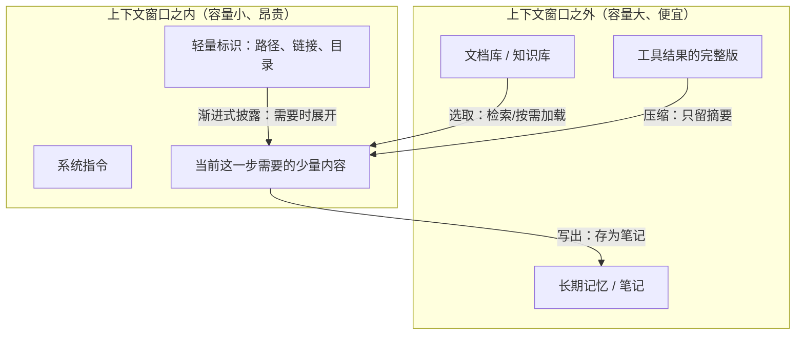

# 上下文工程（Context Engineering）

<!-- CARD:START -->
> **一句话**：为大模型的每一步推理挑选、组织、压缩"恰好够用"的信息，让它在有限的上下文窗口里看到正确的东西。
>
> **30 秒版**：大模型只能"看见"上下文窗口里的内容，而窗口既有容量上限，又不是越满越好——实验表明内容越长、无关信息越多，模型越容易出错。所以与其只琢磨"提示词怎么写"，不如把整个上下文当作稀缺资源来管理：哪些信息存到外面、什么时候取回来、怎么压缩、怎么分给不同的子任务。2025 年起，业界用"上下文工程"来称呼这门手艺。

**关键要点**

- 定义（业界通行说法）：用"恰好合适的信息"填充上下文窗口的艺术与科学
- 为什么需要：上下文有限且会"腐化"——长度增加、信息位于中间、无关内容干扰，都会降低准确率
- 四类常用策略：**写出**（存到窗口外）、**选取**（按需取回）、**压缩**（只留必要的 token）、**隔离**（拆给不同子任务）
- 关键技巧：即时检索、渐进式披露、结构化笔记、上下文压缩、子智能体
- 它包含提示词工程，但范围更大：系统指令、工具、记忆、检索结果、对话历史都要管

**最常见的误解**：❌ 上下文窗口越大，就把所有资料都塞进去 → ✅ 窗口大小是"能装多少"，不是"能用好多少"；只放与当前一步相关的高信号信息
<!-- CARD:END -->

> 📚 **前置知识**：大语言模型的基本工作方式、[注意力机制](attention-mechanism.md)（理解上下文为什么有成本） ｜ 🎯 **读完你应该能**：解释上下文为什么"不是越多越好"；说出四类策略并举例；用渐进式披露的思路整理自己的资料

---

## 1. 是什么：定义与口径

**定义**（业界来源交叉；目前没有学术界统一的标准定义）：

> 上下文工程是"用恰好合适的信息填充上下文窗口、以支撑下一步推理的精细艺术与科学"。——Andrej Karpathy，2025-06-25[^karpathy]
>
> 它是"提供完整上下文、让任务对大模型而言**有可能**被解决的艺术"。——Tobi Lütke（Shopify CEO），2025-06-18[^lutke]
>
> Anthropic 的定义：在大模型推理期间，策划并维护最优 token 集合（信息）的一组策略，包括提示词之外所有可能进入上下文的信息[^ce]。

三种说法的共同点：**对象是整个上下文窗口**（不只是提示词），**目标是"恰好够用"**（不是越多越好）。【主流】

**白话拆解**：把大模型想成一位非常聪明、但**只能看见桌面上那几页纸**的专家。上下文工程就是那位"秘书"的工作：决定此刻桌上该放哪几页、哪些先收进柜子、哪些要摘要成一页、哪些交给另一位专家去处理。

> **类比的失效边界**：人类专家可以主动去柜子里翻资料；大模型只有在系统提供了"检索工具"并被允许调用时才能这样做。而且模型对桌面上的纸并非一视同仁——位置、长度、干扰内容都会影响它读得好不好（第 2 节）。

**口径边界**：

- **包括**：系统提示、工具定义、示例、检索到的资料、对话历史、长期记忆、工具调用结果、子任务的结果摘要……一切进入上下文窗口的东西[^ce][^lcrepo]
- **不包括**：训练或微调模型本身（那改变的是模型参数，而不是推理时的上下文）
- **与相邻术语**：提示词工程是它的子集[^cn-53ai]；检索增强生成（RAG）是其中"选取"策略的一种实现[^rag]

## 2. 为什么：它解决什么问题

**根本原因：上下文是有限且会"腐化"的资源。** 证据来自多项独立研究【共识】：

| 现象 | 发现 | 来源 |
|---|---|---|
| 位置效应 | 相关信息在长上下文**中间**时，模型表现显著下降；在开头或结尾时最好 | [^lim] |
| 干扰效应 | 数学题中加入无关信息，模型解题准确率明显下降 | [^gsmic] |
| 有效长度不足 | 在比"大海捞针"更复杂的任务上，模型随上下文变长明显退化，实际可用长度远小于宣称长度 | [^ruler] |
| 上下文腐化（context rot） | 对 18 个模型的测试：输入越长，表现越不可靠，即使任务很简单 | [^rot] |

Anthropic 把这概括为"注意力预算"：Transformer 中 n 个 token 两两之间有 n² 种关系，上下文越长，这种能力被摊得越薄[^ce]（背后的机制见[注意力机制](attention-mechanism.md)）。

**工程上的直接压力：智能体（Agent）。** 一个要连续调用几十上百次工具的智能体，上下文会被工具返回结果迅速填满，导致超出窗口、成本与延迟飙升、表现下降[^lcrepo]。Cognition 公司称上下文工程"实际上是构建 AI 智能体的工程师的头号工作"（LangChain 资料转引）[^lcrepo]。

**四种典型的失败方式**（Drew Breunig 的归纳）[^breunig]：

| 失败 | 表现 |
|---|---|
| 上下文中毒（poisoning） | 一个幻觉或错误进入上下文后被反复引用 |
| 上下文分心（distraction） | 上下文太长，模型过度依赖上下文而忽略训练中学到的知识 |
| 上下文混淆（confusion） | 多余的信息被模型拿去用，导致低质量回答 |
| 上下文冲突（clash） | 新加入的信息或工具与已有内容相互矛盾 |

## 3. 怎么运作：机制与结构

### 3.1 上下文里有什么

LangChain 把需要管理的上下文分为三类[^lcrepo]：

- **指令**：提示词、记忆、少样本示例、工具描述
- **知识**：事实、记忆
- **工具**：工具调用返回的结果

Karpathy 的类比（经 LangChain 转述）：大模型像一种新的操作系统，模型是 **CPU**，上下文窗口是 **内存（RAM）**——容量有限的工作记忆；上下文工程就像操作系统决定什么数据该放进内存[^lcrepo]。

> **类比的失效边界**：内存里的数据要么在、要么不在，CPU 读取时不会"走神"；而上下文窗口里的内容即使"在"，也可能因为位置或干扰而没被用好（第 2 节）。

### 3.2 四类策略：写出、选取、压缩、隔离

| 策略 | 定义[^lcrepo] | 常见做法 |
|---|---|---|
| **写出**（write） | 把信息存到上下文窗口**之外** | 草稿本、长期记忆、结构化笔记（Anthropic 称为 structured note-taking[^ce]） |
| **选取**（select） | 按需把信息**取回**窗口 | 检索增强生成（RAG）[^rag]、按文件路径/链接即时加载[^ce] |
| **压缩**（compress） | 只保留完成任务**必需**的 token | 摘要、裁剪旧的工具结果；接近窗口上限时把对话总结后重开新窗口（compaction）[^ce] |
| **隔离**（isolate） | 把上下文**拆分**给不同的执行单元 | 子智能体：各自在干净的上下文里工作，只把结果摘要交回主智能体[^ce] |

### 3.3 即时检索与渐进式披露

与其预先把所有资料塞进上下文，不如只保留**轻量的标识**（文件路径、查询语句、链接），在运行时用工具动态加载[^ce]。在此基础上，**渐进式披露**让智能体通过探索逐步发现相关上下文，每一步的结果决定下一步加载什么[^ce]。

Anthropic 的 Agent Skills 是一个具体实现：启动时只把每个技能的**名字和描述**放进系统提示；判断相关后才读取完整的 SKILL.md；技能目录中的其他文件仅在需要时才打开——"像一本先有目录、再有章节、最后有附录的手册"[^skills]。

学术上的先驱之一是 MemGPT：借鉴操作系统的**分层内存**，在快慢存储之间搬运数据，让模型"看起来"拥有超出上下文窗口的记忆（预印本）[^memgpt]。



## 4. 从哪来：起源与演变

| 时间 | 事件 | 来源 |
|---|---|---|
| 2020 | Lewis 等提出检索增强生成（RAG），把模型参数中的"参数化记忆"与可检索的"非参数化记忆"结合 | [^rag] |
| 2023 | MemGPT 借鉴操作系统虚拟内存，提出"虚拟上下文管理" | [^memgpt] |
| 2023–2024 | "Lost in the Middle"、GSM-IC、RULER 等研究揭示长上下文的位置效应、干扰效应与有效长度不足 | [^lim][^gsmic][^ruler] |
| 2025-06-18 | Tobi Lütke 表示更喜欢"上下文工程"而非"提示词工程" | [^lutke] |
| 2025-06-25 | Karpathy 发文 "+1 for context engineering"，术语迅速流行 | [^karpathy] |
| 2025-06 | Drew Breunig 归纳长上下文的四种失败方式；LangChain 归纳写出/选取/压缩/隔离四类策略 | [^breunig][^lcrepo] |
| 2025-07-14 | Chroma 发布"Context Rot"报告，18 个模型随输入变长表现越来越不可靠 | [^rot] |
| 2025-09-29 | Anthropic 发布《Effective context engineering for AI agents》 | [^ce] |
| 2025-10-16 | Anthropic 发布 Agent Skills，以渐进式披露组织技能 | [^skills] |

> **演变主线**：检索增强（给模型外挂知识）→ 分层记忆（像操作系统一样管理）→ 实证发现"长上下文不可靠" → 2025 年形成统一术语与方法论，重心从"写好一句提示"转向"管理整个上下文"。

## 5. 看例子：本仓库就是一个上下文工程实例

**问题**：用户问"为什么注意力要除以 √d_k？"。比较两种加载方式（截至 2026-10-06 本仓库实测，可用命令复现）：

| 方式 | 加载的内容 | 字符数 |
|---|---|---|
| A. 全文加载 | 读入整篇 `attention-mechanism.md` | 16,304 |
| B. 渐进式披露 | ① `kb.py find 注意力`（127）→ ② `kb.py card attention-mechanism`（719）→ ③ `kb.py section attention-mechanism 3.2`（1,151） | 1,997 |

```
B / A = 1,997 / 16,304 ≈ 12.2%
```

方式 B 只用约八分之一的上下文就拿到了回答所需的全部信息（卡片给出结论，3.2 节给出推导和数字），**而且没有带入与问题无关的 KV 缓存、历史、争议等章节**——按第 2 节的研究，这些无关内容不仅浪费 token，还可能干扰回答。

> 复现：`python3 tools/kb.py card attention-mechanism | wc -m` 等。条目内容更新后数字会变化，比例的量级不会变。
> 注意：字符数不等于 token 数，这里只用于比较相对大小。

这对应第 3.2 节的四类策略：**写出**（知识写进条目文件）、**选取**（find/card/section 按需加载）、**压缩**（卡片 ≤25 行是全文的压缩版）、**隔离**（每个概念一个文件，关联时只加载邻居的一句话）。整体设计见 [system/ARCHITECTURE.md](../../system/ARCHITECTURE.md)。

## 6. 别搞混：辨析与误区

| 对比对象 | 相同点 | 关键区别 |
|---|---|---|
| 提示词工程（Prompt Engineering） | 都是在推理时影响模型行为，不改参数 | 提示词工程关注"指令怎么写"，多为一次性任务；上下文工程管理整个窗口（指令、工具、记忆、检索、历史），多为系统级、动态的[^cn-53ai][^karpathy] |
| 检索增强生成（RAG） | 都要把外部知识引入上下文 | RAG 是"选取"策略的一种具体技术；上下文工程还包括写出、压缩、隔离等[^lcrepo][^rag] |
| 长上下文模型 | 都想让模型利用更多信息 | 扩大窗口是"把桌子变大"；上下文工程是"决定桌上放什么"。两者互补，但窗口变大并不自动解决位置效应与干扰问题[^lim][^rot] |
| 微调（Fine-tuning） | 都能让模型更适合某个任务 | 微调改变模型参数；上下文工程只改变推理时的输入 |

**常见误区**

- ❌ "窗口有 100 万 token，就把所有资料都塞进去" → ✅ 有效长度通常远小于宣称长度，无关内容还会干扰[^ruler][^rot]。
- ❌ "上下文工程就是换了个说法的提示词工程" → ✅ 提示词只是上下文的一部分；智能体场景中，工具结果和历史往往才是上下文的大头[^lcrepo]。
- ❌ "压缩/摘要总是安全的" → ✅ 摘要可能丢失关键细节，或把错误固化进上下文（上下文中毒）[^breunig]。
- ❌ "多智能体一定更好" → ✅ 隔离能保持上下文干净，但子任务之间可能缺少彼此的上下文；是否拆分要看任务（见第 7 节）。

## 7. 怎么看：多方视角与争议

| 议题 | 观点 | 依据 |
|---|---|---|
| 术语是否必要 | **支持**：提示词让人联想到"一句话的任务描述"，低估了工业级应用中填充上下文的工作量 | Karpathy[^karpathy]、Lütke[^lutke] |
| | **审慎**：中文社区多认为两者是"包含与演进"而非"替代与淘汰"，提示词工程仍是执行层的核心 | 中文技术社区[^cn-53ai] |
| 多智能体与隔离 | **支持**：子智能体在干净的上下文中工作，主智能体只综合结果，实现关注点分离 | Anthropic[^ce] |
| | **审慎**：Cognition 的文章题为"不要构建多智能体"（Don't Build Multi-Agents），强调共享上下文的重要性 | LangChain 资料转引[^lcrepo] |
| 长窗口能否取代上下文工程 | **经验证据**：截至 2025 年的测试中，前沿模型仍随输入变长而退化 | [^rot][^ruler] |
| | **开放问题**：模型长上下文能力仍在快速进步，最佳实践可能随之改变 | 本条目判断【争议】 |

- **共识**：上下文是有限资源；无关信息有害；按需加载优于一次性灌入。【共识】
- **分歧**：多智能体隔离的适用边界；未来模型进步后哪些技巧会过时。【争议】

## 8. 怎么用：应用与启发

**用 AI 时（个人）**

1. 一个对话只做一件事；话题变了就开新对话（隔离）。
2. 给资料前先筛选，只给与问题相关的部分；关键要求放在开头或结尾（选取 + 位置效应）。
3. 长对话中定期让 AI 总结"目前的结论和待办"，再带着总结开新对话（压缩）。
4. 重要结论写进笔记或文件，而不是指望 AI"记得"（写出）。

**构建 AI 应用时**

- 给智能体文件路径、查询工具，而不是把全部资料预先塞进提示（即时检索）。
- 把知识组织成"索引 → 摘要 → 全文"的层级（渐进式披露），本仓库的 L0/L1/L2 就是一例。
- 工具返回大量结果时，只把摘要放回上下文，完整结果存到外部。
- 监控上下文长度与回答质量的关系，不要假设"更多 = 更好"。

**对个人知识管理的启发**：人的工作记忆同样有限。把知识按"一句话 → 卡片 → 全文"分层整理、用链接而不是复制来建立关联，既方便 AI 检索，也方便自己复习。

## 9. 自测

<details><summary>Q1. 既然模型的上下文窗口越来越大，为什么还需要上下文工程？</summary>

答：窗口大小只决定"能装多少"，不决定"能用好多少"。研究显示相关信息位于中间时表现下降、无关信息会干扰、有效长度远小于宣称长度。此外更长的上下文意味着更高的成本和延迟。（第 2 节）
</details>

<details><summary>Q2. 写出、选取、压缩、隔离四类策略分别是什么？各举一例。</summary>

答：写出——把信息存到窗口外（笔记、长期记忆）；选取——按需取回（RAG、按路径读取文件）；压缩——只保留必要 token（摘要、compaction）；隔离——拆分给不同执行单元（子智能体）。（第 3.2 节）
</details>

<details><summary>Q3. 上下文工程和提示词工程是什么关系？</summary>

答：提示词工程是上下文工程的子集。前者关注指令的写法，多用于单次任务；后者管理进入上下文窗口的全部信息（指令、工具、记忆、检索结果、历史），多用于系统级、多轮的应用。（第 1、6 节）
</details>

<details><summary>Q4. 什么是"上下文中毒"？压缩上下文时为什么要警惕它？</summary>

答：上下文中毒指一个幻觉或错误进入上下文后被反复引用。压缩/摘要如果把错误写进了摘要，错误就会被"固化"并在后续每一步中被当作事实使用。（第 2、6 节）
</details>

<details><summary>Q5. 用自己的话解释"渐进式披露"，并说明本仓库是怎么实现它的。</summary>

答：先只给最轻量的信息（名字、一句话、目录），确认相关后再加载更多细节，需要时才打开完整内容。本仓库：find（L0 一句话）→ card（L1 卡片）→ section（L2 单章），关联时只加载邻居的一句话。（第 3.3、5 节）
</details>

<details><summary>Q6.（计算）一篇 20,000 字符的文档，回答问题只需要 800 字符的卡片和 1,500 字符的一节。按需加载比全文加载节省了多少比例的上下文？</summary>

答：按需加载 2,300 字符，占 2,300 / 20,000 = 11.5%，节省 88.5%。（第 5 节的方法）
</details>

## 10. 关联

<!-- RELATIONS:START -->
**出链**（本条 → 其他）

- **前置知识** → [注意力机制](attention-mechanism.md)：上下文为什么有限：注意力的 n² 成本与长上下文中的位置效应
- **前置知识** → `large-language-model` 〔待建〕：要先知道模型只能看见上下文窗口里的内容
- **区别于** → `prompt-engineering` 〔待建〕：提示词工程关注"怎么写指令"，是上下文工程的子集
- **相关** → `retrieval-augmented-generation` 〔待建〕："选择"策略的代表技术
- **应用于** → `ai-agent` 〔待建〕：多轮工具调用的智能体是上下文工程的主战场
- **相关** → `working-memory` 〔待建〕：常用的类比：上下文窗口像工作记忆/内存

> 学习路径：`python3 tools/kb.py path context-engineering` ｜ 一跳邻居：`python3 tools/kb.py neighbors context-engineering`
<!-- RELATIONS:END -->

## 11. 来源

> 检索覆盖：学术（4 篇论文）/ 一手行业资料（Anthropic 两篇工程文章全文、LangChain 资料全文）/ 当事人原话（两条推文）/ 专业解读 / 中文社区；语种：中文、英文。
> 未能访问：arxiv.org、research.trychroma.com、x.com 等站点无法直接打开全文，相关来源依据检索摘要核实。

[^karpathy]: **S2** · Andrej Karpathy，X 帖子，2025-06-25 · <https://x.com/karpathy/status/1937902205765607626> · 核实：摘要 · 访问 2026-10-06 · 支撑："+1 for context engineering"；"填充上下文窗口的精细艺术与科学"的原话
[^lutke]: **S2** · Tobi Lütke，X 帖子，2025-06-18 · <https://x.com/tobi/status/1935533422589399127> · 核实：摘要 · 访问 2026-10-06 · 支撑："提供完整上下文、让任务有可能被大模型解决的艺术"的原话
[^ce]: **S2** · Anthropic Engineering, *Effective context engineering for AI agents*, 2025-09-29 · <https://www.anthropic.com/engineering/effective-context-engineering-for-ai-agents> · 核实：全文 · 访问 2026-10-06 · 支撑：Anthropic 的定义；注意力预算与 n²；即时检索；渐进式披露；结构化笔记；compaction；子智能体
[^skills]: **S2** · Anthropic Engineering, *Equipping agents for the real world with Agent Skills*, 2025-10-16 · <https://www.anthropic.com/engineering/equipping-agents-for-the-real-world-with-agent-skills> · 核实：全文 · 访问 2026-10-06 · 支撑：技能的三级渐进式加载；"目录—章节—附录"的比喻
[^lcrepo]: **S2** · LangChain, *Context Engineering with LangGraph*（GitHub 仓库 README） · <https://github.com/langchain-ai/context_engineering> · 核实：全文 · 访问 2026-10-06 · 支撑：写出/选取/压缩/隔离四类策略的定义；指令/知识/工具三类上下文；Karpathy 的 CPU/RAM 类比；Cognition"头号工作"与"Don't Build Multi-Agents"的引用；智能体的 token 膨胀问题
[^breunig]: **S2** · Drew Breunig, *How Long Contexts Fail* / *How to Fix Your Context*, 2025-06 · <https://www.dbreunig.com/> · 核实：摘要 · 访问 2026-10-06 · 支撑：上下文中毒、分心、混淆、冲突四种失败方式
[^lim]: **S1** · Liu, N. F. et al., *Lost in the Middle: How Language Models Use Long Contexts*, TACL 12:157–173, 2024 · <https://aclanthology.org/2024.tacl-1.9/> · 核实：摘要 · 访问 2026-10-06 · 支撑：位置效应
[^gsmic]: **S1** · Shi et al., *Large Language Models Can Be Easily Distracted by Irrelevant Context*, ICML 2023 (PMLR 202) · <https://proceedings.mlr.press/v202/shi23a.html> · 核实：摘要 · 访问 2026-10-06 · 支撑：无关上下文降低准确率（GSM-IC）
[^ruler]: **S1** · Hsieh, C.-P. et al., *RULER: What's the Real Context Size of Your Long-Context Language Models?*, COLM 2024 · <https://arxiv.org/abs/2404.06654> · 核实：摘要 · 访问 2026-10-06 · 支撑：有效上下文长度远小于宣称长度
[^rot]: **S2** · Chroma, *Context Rot: How Increasing Input Tokens Impacts LLM Performance*, 2025-07-14 · <https://research.trychroma.com/context-rot> · 核实：摘要 · 访问 2026-10-06 · 支撑：18 个模型随输入变长表现越来越不可靠
[^memgpt]: **S1** · Packer, C. et al., *MemGPT: Towards LLMs as Operating Systems*, arXiv 2023（预印本） · <https://arxiv.org/abs/2310.08560> · 核实：摘要 · 访问 2026-10-06 · 支撑：虚拟上下文管理；借鉴操作系统分层内存
[^rag]: **S1** · Lewis, P. et al., *Retrieval-Augmented Generation for Knowledge-Intensive NLP Tasks*, NeurIPS 2020, pp. 9459–9474 · <https://arxiv.org/abs/2005.11401> · 核实：摘要 · 访问 2026-10-06 · 支撑：参数化与非参数化记忆结合；RAG 的提出
[^cn-53ai]: **S3** · 53AI《Context Engineering 上下文工程是什么？和提示词工程有什么联系？》及 CSDN、知乎同类文章 · <https://www.53ai.com/news/tishicikuangjia/2025081170216.html> · 核实：摘要 · 访问 2026-10-06 · 支撑：中文社区对"提示词工程是上下文工程子集""包含与演进而非替代"的通行看法

## 12. 我的思考

> 留白，只由仓库主人填写。引导问题：
> - 我和 AI 的对话里，最常出现哪一种"上下文失败"？
> - 我自己的笔记/资料，能不能也按"一句话 → 卡片 → 全文"整理？
> - 本仓库的分层设计，还有哪里可以更省上下文？

## 变更记录

- 2026-10-06 创建（深度级）。置信度定为"中"：核心定义来自业界（S2）而非学术标准；实证部分（第 2 节）有 S1 支撑。
