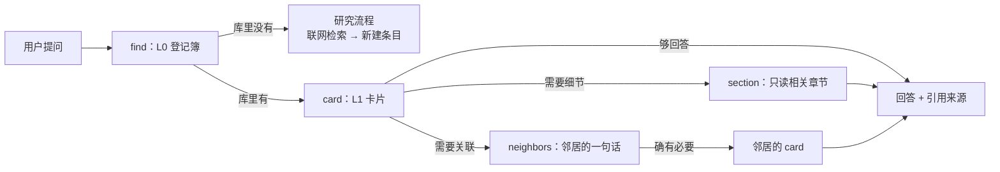

# 🏗️ 系统架构：分层记忆 + 按需关联

> 适用对象：想了解"这个仓库为什么这样组织"的人，以及第一次接手维护的 AI。
> 日常检索与写作不需要读本文件，读 [`AGENTS.md`](../AGENTS.md) 即可。

## 0. 一句话

**把知识库做成"给人读的百科 + 给 AI 用的分层记忆"**：一个概念一个文件；每个文件分三层（一句话 → 卡片 → 章节）；关系写在条目自己的元数据里，由脚本推导出全局索引、图谱和反向链接。AI 每次只加载回答问题所需的最小上下文。

---

## 1. 要解决的两个问题

### 1.1 人的问题：搜得到，但学不透

搜索引擎返回的是**网页**，不是**知识**：信息碎片化、广告干扰、单一来源、深度不足，看完也留不下东西。本系统的回应是"约法三章"：

| 原则 | 系统里的落地方式 |
|---|---|
| ① 准确性第一 | 来源分级（S1/S2/S3）+ 核实方式标注 + 论断级脚注 + 置信度底线写进校验脚本 |
| ② 兼听则明 | 检索矩阵强制覆盖多类平台、中英文；共识与分歧分开标注 |
| ③ 讲明白 | 理解梯度（一句话 → 30 秒 → 全文）+ 八维解析 + 可复算的实例 + 类比必须写明失效边界 |

### 1.2 AI 的问题：上下文越多，不一定越准

你提出的担忧是对的，而且有实证支持：

- **位置效应**：当相关信息位于长上下文的中间时，模型表现显著下降；信息在开头或结尾时最好（"Lost in the Middle"，TACL 2024）[^lim]。【共识】
- **干扰效应**：在数学题里加入无关信息，模型的解题准确率会明显下降（GSM-IC 数据集，ICML 2023）[^gsmic]。【共识】
- **有效长度 < 宣称长度**：在比"大海捞针"更复杂的任务上，所有被测模型都随上下文变长而明显退化（RULER，2024）[^ruler]；2025 年对 18 个前沿模型的测试同样发现输入越长、表现越不可靠（Chroma "Context Rot"）[^rot]。【共识】
- **工程界的结论**：Anthropic 把上下文视为一种有限的"注意力预算"，并把原因联系到 Transformer 中 n 个 token 两两之间的 n² 种关系——上下文越长，这种建模能力被摊得越薄；因此建议只保留"最小且高信号"的 token 集合，并用"即时检索（just-in-time）"和"渐进式披露（progressive disclosure）"按需加载[^ce]。【主流】

> ⚠️ 口径说明：上面是**经验规律**。"softmax 让注意力权重总和为 1，所以无关 token 会稀释注意力"是常见的直觉解释，但不是被严格证明的唯一原因，本库不把它当作定论。

**结论：上下文不是越多越好。无关内容不仅浪费 token，还会降低准确率。** 这正是你提出的"分块整理、按需链接"架构要解决的事，下面把它工程化。

---

## 2. 设计原则

| # | 原则 | 含义 |
|---|---|---|
| P1 | **原子化** | 一个概念一个文件，一个文件只讲一个概念。其他地方提到它就链接，不复制内容（单一权威位置） |
| P2 | **分层披露** | 每个条目都有 L0（一句话）、L1（卡片）、L2（章节）三层，AI 由浅入深按需读取 |
| P3 | **关系本地化** | 关系只在条目自己的 front-matter 里声明；全局图谱、反向链接、研究前沿全部由脚本推导，不手工维护 |
| P4 | **按需关联** | 只有回答确实需要时，才沿关系加载邻居——而且先只加载邻居的一句话（L0） |
| P5 | **规范即代码** | 写作规范、来源底线由 `kb.py check` 强制校验，CI 自动执行，不靠自觉 |
| P6 | **可追溯** | 关键论断都用脚注指向带分级、带核实方式的来源 |
| P7 | **人机两用** | 同一份 Markdown：在 GitHub 上人可以直接读；AI 可以按块取用 |

---

## 3. 分层记忆模型

| 层 | 内容 | 体量 | 什么时候加载 | 怎么加载 |
|---|---|---|---|---|
| **L0 登记簿** | 每个条目一行：id、名称、一句话 | 每条约 1 行 | 每次检索的第一步：确认"库里有没有" | `kb.py find <词>` 或读 `INDEX.md` |
| **L1 卡片** | 一句话 + 30 秒版 + 3–5 条要点 + 最常见误解 | ≤ 25 行 | 确认条目相关之后 | `kb.py card <id>` |
| **L2 章节** | 八维解析中的某一维 | 单章 | 问题需要细节时（只取相关章节） | `kb.py outline <id>` → `kb.py section <id> <章>` |
| **L3 来源** | 外部原文 | — | 需要核实或深挖时 | 章节自动附带所引来源的链接 |
| **图层** | 条目之间的关系 | 每条关系 1 行 | 问题涉及"关联/对比/前置"时 | `kb.py neighbors <id>`（只给邻居的 L0） |

一个典型问答的加载路径：



**对比**：如果把整个知识库或整篇文档塞进上下文，回答一个定义问题可能要加载几千行；按上面的路径通常只需要几十行。

---

## 4. 组件

```
Info-Searching-V2/
├── AGENTS.md / CLAUDE.md   # AI 协作协议入口：核心规则 + 路由表（短，每次会话加载）
├── INDEX.md                # L0 登记簿（自动生成）
├── kb/<领域>/<id>.md        # 知识本体：每个条目一个文件
├── kb/<领域>/README.md      # 领域导读 + 自动目录 + 局部关系图
├── graph/                  # 派生物：graph.json（机器读）、frontier.md（研究前沿）
├── system/                 # 体系规范（按需加载，不在每次会话里全读）
├── templates/              # 六种条目类型的模板
├── tools/kblib.py          # 核心库：解析 / 校验 / 生成 / 检索
├── tools/kb.py             # 命令行
├── tools/mcp_server.py     # MCP 服务：把分层检索开放给任意 AI 客户端
├── .claude/skills/         # Claude Code 技能：/research、/deepen、/review
├── site/                   # 网页阅读器（搜索 + 关系图 + 渲染）
└── .github/workflows/      # CI 校验 + GitHub Pages 发布
```

| 组件 | 解决什么 |
|---|---|
| `kb.py` 命令行 | 人和 AI 共用的一套检索与维护命令；只依赖 Python 标准库，任何电脑都能跑 |
| MCP 服务 | Claude Code / Claude Desktop / Cursor 等支持 MCP 的客户端，可以直接调用 `kb_find`、`kb_card`、`kb_section` 等工具做分层检索，不需要读文件 |
| Skills | 把"研究一个新词"的完整流程封装成技能；技能本身也是渐进式披露——平时只有名字和描述在上下文里，用到时才加载全文[^skills] |
| CI | 每次推送都运行校验，保证规范不会随时间腐坏 |
| 网页阅读器 | 不打开 GitHub 也能检索、阅读、看关系图 |

---

## 5. V1 → V2：去劣存优

参考对象：[`info-search`](https://github.com/1739467001-svg/info-search)（12 篇文档，有内容）与 [`Information-Search-Agent`](https://github.com/1739467001-svg/Information-Search-Agent)（分析时为空仓库）。

### 5.1 保留的长处

- 三种输入对应三种模板（关键词 / 概念 / 书名）的思路 → 扩展为六种条目类型
- "三层可读"（一句话 → 详细 → 来源）→ 升级为 L0/L1/L2 分层，并让它可被程序按层读取
- 置信度分级、深度底线、"只列实际访问过的来源，编造链接是最高禁忌"
- "我的思考"留白区：区分"资料堆"和"知识库"的关键
- 关系图谱、待研究队列、深度回填队列
- front-matter + 脚本自动生成索引
- "聊天轻、文档深"

### 5.2 改掉的短处

| V1 问题 | 后果 | V2 方案 |
|---|---|---|
| `relations.md` 是单一大文件，节点表、边表、mermaid 三处手工同步 | 随规模线性膨胀，每次都要整篇读；三处容易不一致 | 关系写在各条目的 front-matter；图谱、反向链接、前沿队列全部由脚本推导 |
| 按文档类型分目录（concepts/topics/books） | 覆盖全学科后难以浏览 | 按**领域**分目录，类型用 `kind` 字段表达 |
| 一篇文档承载多个节点（如"机器学习全景"内含深度学习、强化学习、持续学习） | 节点与文件不一一对应，无法按需加载 | 原子化：一个概念一个文件；专题（topic）只做导航和综述，链接到概念条目 |
| 中文文件名、没有稳定 id | 链接需要 URL 编码，改名即断链 | kebab-case 英文 id 作文件名；中文名、别名放在 `title` / `aliases` |
| 深度底线只写在文档里 | 实际出现了"0 个已核实来源却标置信度中"的条目 | 底线写进 `kb.py check`，CI 强制 |
| 来源集中列在文末 | 读者无法知道哪个论断由哪个来源支撑 | 脚注逐论断引用；每个来源标注分级与核实方式 |
| 没有卡片层 | AI 为了一个定义要读 150 行 | 每个条目有 ≤25 行的卡片，可单独加载 |
| 规范写在 README，人机混杂 | 每次会话都得加载全部规范 | `AGENTS.md` 只放核心规则和路由表，细则放 `system/` 按需读取 |
| 章节编号不统一（如"3.5 节"、重复的"四、"） | 无法用程序定位章节 | 统一的维度关键词，校验脚本检查 |
| 没有时效管理 | AI、商业类内容过时也无人知晓 | `review_after` 字段 + `kb.py due` + 前沿页的复核计划 |

---

## 6. 已知局限与取舍

- **关系需要人工声明**：好处是准确、可解释；代价是可能漏连。未来计划由 AI 根据正文建议关系，人工确认（见 ROADMAP）。
- **检索是关键词匹配，不是语义检索**：对同义词依赖 `aliases` 字段。未来计划加入向量检索与关键词检索的混合检索。
- **核实受网络环境影响**：部分站点无法抓取全文时，只能依据检索摘要核实。系统用"核实方式"字段如实记录（全文 / 摘要 / 转引），置信度规则据此收紧，而不是假装读过。

---

[^lim]: **S1** · Liu, N. F. et al., *Lost in the Middle: How Language Models Use Long Contexts*, TACL 12:157–173, 2024 · <https://aclanthology.org/2024.tacl-1.9/> · 核实：摘要 · 访问 2026-10-06 · 支撑：相关信息位于中间时表现显著下降
[^gsmic]: **S1** · Shi et al., *Large Language Models Can Be Easily Distracted by Irrelevant Context*, ICML 2023 (PMLR 202) · <https://proceedings.mlr.press/v202/shi23a.html> · 核实：摘要 · 访问 2026-10-06 · 支撑：无关上下文降低解题准确率
[^ruler]: **S1** · Hsieh, C.-P. et al., *RULER: What's the Real Context Size of Your Long-Context Language Models?*, COLM 2024 · <https://arxiv.org/abs/2404.06654> · 核实：摘要 · 访问 2026-10-06 · 支撑：有效上下文长度显著小于宣称长度
[^rot]: **S2** · Chroma, *Context Rot: How Increasing Input Tokens Impacts LLM Performance*, 2025-07-14 · <https://research.trychroma.com/context-rot> · 核实：摘要 · 访问 2026-10-06 · 支撑：18 个模型随输入变长表现越来越不可靠
[^ce]: **S2** · Anthropic Engineering, *Effective context engineering for AI agents*, 2025-09-29 · <https://www.anthropic.com/engineering/effective-context-engineering-for-ai-agents> · 核实：全文 · 访问 2026-10-06 · 支撑：注意力预算、n² 关系、即时检索、渐进式披露
[^skills]: **S2** · Anthropic Engineering, *Equipping agents for the real world with Agent Skills*, 2025-10-16 · <https://www.anthropic.com/engineering/equipping-agents-for-the-real-world-with-agent-skills> · 核实：全文 · 访问 2026-10-06 · 支撑：技能的三级渐进式加载
