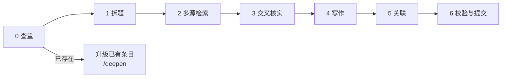

# 🔬 研究流程：从一个词到一个条目

> 何时读：用户给出一个名词/概念/问题，需要联网研究并沉淀为条目时。
> Claude Code 用户可直接用 `/research <词>`，该技能会按本流程执行。

## 总览



## 第 0 步：查重（先查库，再上网）

```bash
python3 tools/kb.py find <词>          # 标题、英文名、别名、标签都会匹配
python3 tools/kb.py find <英文名>
```

- **已存在** → 读卡片（`kb.py card <id>`）。用户只是想了解 → 直接基于卡片回答；用户想要更深 → 走 `/deepen` 升级流程。
- **在研究前沿里（待建）** → 说明已有条目引用了它，新建时记得核对那些引用者的关系是否准确。
- **不存在** → 继续。

## 第 1 步：拆题

在动手检索前，写下（可以只在心里/对话里）：

1. **定位**：这个词属于哪个领域（`domain`）、哪种类型（`kind`）？有没有同名异义（如"熵"在热力学和信息论里）？本条目讲哪一个？
2. **问题清单**：按该类型的八个维度，各列 1–2 个具体问题。例："注意力为什么要除以 √d？""自注意力和交叉注意力有什么区别？"
3. **前置知识**：读懂它需要先懂什么？（将成为 `based-on` 关系）
4. **易混概念**：它最常和什么混淆？（将成为 `contrasts` 关系）

## 第 2 步：多源检索（兼听则明）

按 [source-policy.md](source-policy.md) 第 9 节的检索矩阵，**至少覆盖 4 类来源、中英文都查**。实用的检索式：

| 目的 | 检索式示例 |
|---|---|
| 权威定义 | `<英文名> definition encyclopedia` · `<中文名> 定义 教材` |
| 原始出处 | `<英文名> original paper <年份>` · `<人名> <年份> <标题关键词>` |
| 机制讲解 | `<英文名> explained` · `<中文名> 原理 图解` |
| 历史演变 | `history of <英文名>` · `<中文名> 发展历程` |
| 争议与批评 | `<英文名> criticism` · `<英文名> misconception` · `<中文名> 误区 争议` |
| 最新进展 | `<英文名> <当前年份> survey` · `<中文名> 最新进展` |
| 中文语境 | `<中文名> 知乎` · `<中文名> 是什么意思` |

检索时边读边记：**每条有用信息记下来源与核实方式**（读到全文？只读到摘要？），这是第 3 步的原料。

## 第 3 步：交叉核实

对每个**核心论断**（定义、关键数字、日期、人名、因果判断）：

1. 找到 ≥2 个**独立**来源。同一出处的多次转载只算 1 个。
2. 数字能复算就复算。
3. 来源冲突 → 先查口径；真冲突 → 按 source-policy 第 7 节处理。
4. 找不到第二个来源 → 标【待核】或降低置信度，**不要硬写**。
5. 特别警惕 AI 自己的"记忆"：凡是没有在本次检索中读到的细节，都不能作为事实写入。

## 第 4 步：写作

```bash
python3 tools/kb.py new concept <id> --domain <领域> --title <中文名> --en <英文名>
```

按模板与 [writing-standard.md](writing-standard.md) 填写：

1. **先写正文八个维度**，最后写卡片和 summary（写完全文才知道什么最重要）。
2. 每个关键论断后标脚注 `[^key]`；需要时加【共识】【主流】【争议】【待核】。
3. "看例子"必须是完整、可复算的例子。
4. 每个类比都写失效边界。
5. 写 3–5 道考理解的自测题。
6. 「我的思考」只留引导问题，不代写。
7. 根据实际达到的程度如实填写 `status` 与 `confidence`。

## 第 5 步：关联

在 front-matter 的 `relations` 中声明 3–8 条出链（关系类型见 [taxonomy.md](taxonomy.md) 第 3 节）：

- 第 1 步列出的前置知识 → `based-on`
- 易混概念 → `contrasts`
- 上位概念 → `is-a` / `part-of`
- 它催生的东西 → `leads-to`

然后看一眼已有条目里**有没有应该指向新条目的关系**（`kb.py grep <中文名>`），有的话在那些条目里补上（只补 front-matter，一行即可）。

## 第 6 步：校验与提交

```bash
python3 tools/kb.py index    # 重新生成索引、图谱、反向链接
python3 tools/kb.py check    # 必须 0 错误
```

提交信息格式：`kb(<领域>): 新增「中文名」<成熟度>，<来源数> 来源` 例如 `kb(tech-ai): 新增「注意力机制」深度级，12 来源`。

## 在对话中怎么回答用户

**聊天轻，文档深**：对话里给 L1 级别的回答（30 秒版 + 要点 + 最重要的一两个细节），并给出条目链接；完整内容在条目里。如果用户只是随口一问、不需要沉淀，就直接回答，不必建条目——但仍遵守准确性规则。
